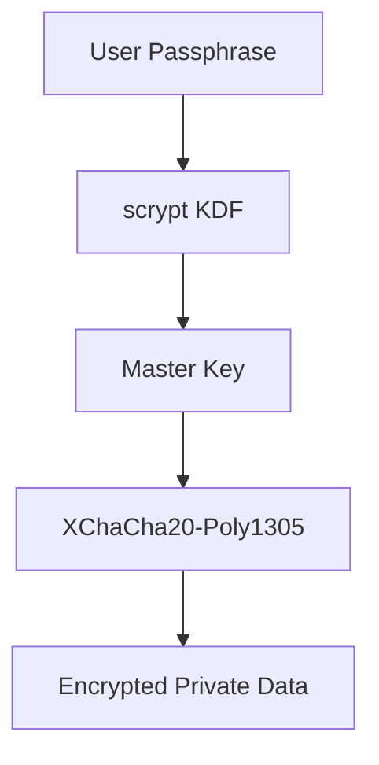

# ADR 0007: XChaCha20-Poly1305 Encryption

## 1. Context

A broader effort simplifies wallet encryption to a single passphrase model.
As part of that effort, we review the cryptographic primitives that protect
sensitive data. Today, `btcwallet` uses NaCl secretbox, based on
XSalsa20-Poly1305, to encrypt private key material.

XSalsa20-Poly1305 is still secure. But modern systems now prefer
XChaCha20-Poly1305 as its successor. XChaCha20-Poly1305 keeps the large nonce
model. It also has better library support and aligns with current AEAD
standards.

The key motivations for this change are:

* Broad adoption of XChaCha20-Poly1305 in modern cryptographic systems
* Strong performance on systems without AES-NI, including mobile and embedded
  environments
* Simpler and more uniform AEAD construction, which reduces implementation
  risk
* Easier audits because of reduced complexity
* Production-proven usage in the Lightning Network's encrypted transport
  protocol ([BOLT
  8](https://github.com/lightning/bolts/blob/master/08-transport.md)),
  demonstrating its suitability for Bitcoin-related projects

Like XSalsa20, XChaCha20-Poly1305 uses a 192-bit nonce. This nonce size
allows random nonce generation without practical collision risk. It also
matches our existing nonce strategy.

## 2. Decision

We will migrate the encryption primitive from NaCl secretbox, based on
XSalsa20-Poly1305, to **XChaCha20-Poly1305**.

### Key aspects

1. **Encryption primitive**
   Use XChaCha20-Poly1305 from `golang.org/x/crypto/chacha20poly1305`,
   specifically the XChaCha variant with 192-bit nonces.

2. **Key hierarchy**
   Preserve the existing structure: scrypt-based KDF, master key derivation,
   and per-use encryption keys.

3. **Data separation**
   Continue to store public data in plaintext, and encrypt only private or
   sensitive material.

4. **Migration path**
   The SQL migration process will re-encrypt encrypted data.

## 3. Consequences

### Pros

* **Performance**
   Strong performance in pure software environments, especially where AES-NI
   is not available.

* **Modern AEAD**
  Aligns the codebase with current best practice for authenticated encryption.

* **Lower implementation risk**
  Fewer edge cases than AES-GCM or custom constructions.

* **Auditability**
  Smaller and clearer code paths are easier to review and to maintain over
  the long term.

* **Nonce safety**
   The 192-bit nonce space allows safe random nonce generation and preserves
   compatibility with existing designs.

### Cons

* **Migration cost**
  All encrypted data must be re-encrypted during migration.

* **Temporary dual support**
  XSalsa20-Poly1305 must remain supported until migration is complete.

* **Testing overhead**
  Both encryption paths require validation during the transition period.

* **Passphrase dependency**
  Re-encryption is possible only when the user passphrase is available.

## 4. Status

Proposed.
