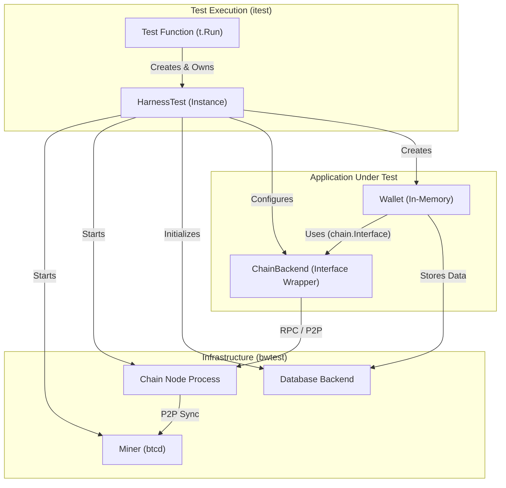

# ADR 0008: Integration Test Framework

## 1. Context

The `btcwallet` project requires a robust integration test framework. The
framework must verify the correctness of the core `wallet` package against
different configurations. The current tests are not sufficient to verify the
complex matrix of supported backends and modes.

The framework must support:
1.  **Multiple Chain Backends**: `btcd` (native), `bitcoind` (external
    process), and `neutrino` (SPV).
2.  **Multiple Database Backends**: `kvdb` (bbolt/etcd), `sqlite`, and
    `postgres`.
3.  **Public API Testing**: Tests that verify the public methods of the
    `wallet` package (e.g., `Create`, `Load`, `Start`, `Stop`).

We need a standard, reusable approach to write integration tests. The tests
must run across all these permutations without duplicate setup logic.

## 2. Decision

We will implement a modular integration test framework. The model for the
framework is `lnd`'s `lntest`, adapted for tests in library mode.

### 2.1. Library-Mode Testing
Tests will run `btcwallet` in **Library Mode** (in-process).
- **Why**: Faster execution, easier debugging, and direct assertions on
  internal state.
- **How**: The test harness instantiates `wallet.Manager` directly.

### 2.2. Architecture & Components

The framework has two parts: `bwtest` (framework) and `itest` (test cases).

#### Component Interaction



*   **`Miner`**: A dedicated `btcd` instance that generates blocks. The Miner
    is the source of truth for the blockchain state.
*   **`Chain Node`**: The software that provides chain data (`btcd`,
    `bitcoind`).
    *   For `btcd` tests: The harness starts a separate `btcd` process as the
        Chain Node. This process connects to the Miner.
    *   For `bitcoind` tests: A separate `bitcoind` process connects (P2P) to
        the Miner to sync.
    *   For `neutrino` tests: There is no separate "Chain Node" process.
        Neutrino connects directly to the Miner.
*   **`ChainBackend`**: The interface wrapper (`rpcclient` or
    `neutrino.ChainService`). The Wallet uses the ChainBackend to communicate
    with the Chain Node.
*   **`Database Backend`**: The storage layer (`kvdb`, `postgres`, `sqlite`).
*   **`HarnessTest`**: The specific test instance. The HarnessTest manages
    unique ports, temp directories, and process lifecycles.

### 2.3. Package Structure

- **`bwtest/`**:
    - `harness.go`: `HarnessTest` orchestrator. Manages `t.Cleanup` for
      resource teardown.
    - `chain_backend.go`: Logic to start and stop the `btcd`/`bitcoind`
      processes and to configure `neutrino`.
    - `miner.go`: `Miner` implementation (controls the primary `btcd`
      instance).
    - `database.go`: Helpers to create and remove DBs (create temp bolt files,
      initialize SQL schemas).
- **`itest/`**:
    - `main_test.go`: Flag parsing (`-chain`, `-db`) and the global test
      runner.
    - `manager_test.go`: Test cases for `wallet.Manager`.

### 2.4. Configuration & Isolation

The `go test` flags control the configuration.

```bash
# Default (btcd + kvdb)
make itest

# Explicit configuration
make itest chain=bitcoind db=postgres

# Run specific test case
make itest case=TestNewWallet
```

*   **Sequential Execution**: Tests run one after the other. Each test starts
    multiple full nodes, which has a high overhead. Sequential execution
    prevents resource exhaustion and port conflicts.
*   **Neutrino Support**: The `Miner` (btcd) will use the `--cfilters` option
    to serve compact block filters. Neutrino clients can then connect directly
    to the Miner for SPV synchronization.

## 3. Implementation Plan

1.  **Scaffold Framework (`bwtest`)**:
    - Implement `Miner` (wraps `rpctest`).
    - Implement the `ChainBackend` logic (start the bitcoind/btcd process,
      configure neutrino).
    - Implement the `Database` setup (initialize the postgres schema, create
      temp sqlite files).
    - Implement `HarnessTest` to orchestrate the dependency graph:
      `Miner -> ChainNode -> ChainBackend -> DB -> Wallet`.
2.  **Scaffold Tests (`itest`)**:
    - Create `manager_test.go` as a proof-of-concept.
3.  **CI Integration**:
    - Update the `Makefile` with `itest` targets that map the flags correctly.

## 4. Consequences

### Pros
- **Consistency**: Clear separation between Network, Infrastructure, and
  Application.
- **Isolation**: Each test has its own harness, which prevents state leaks.
- **Coverage**: The framework can validate the entire support matrix.

### Cons
- **Resource Intensity**: A separate `bitcoind`/`btcd` process for each test
  uses much CPU and RAM.
- **Complexity**: Dynamic port allocation and process lifecycle management
  are error-prone.
- **Execution Time**: Tests will take longer to run because of sequential
  execution and process startup costs.
