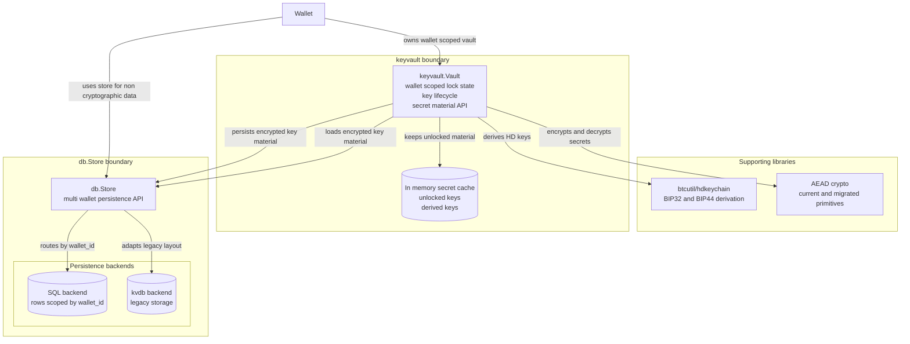

# ADR 0010: Keyvault Encryption Layer

## 1. Context

ADR 0009 defines the encryption model. ADR 0007 proposes a migration of the
cryptographic primitives. Both require a clear boundary between wallet domain
logic and database persistence.

The legacy `waddrmgr` design couples storage, locking, key derivation, and
encryption. This coupling causes three problems:

* The SQL migration is harder.
* Encryption behavior spreads across persistence code.
* Lock state is difficult to test in isolation.

We need a dedicated component that owns lock state, key derivation, the
lifetime of secret material, and encryption. The database layer should stay
encryption agnostic. The database layer should store encrypted key material as
opaque bytes.

Other wallet code can continue to use the `db.Store` for non-cryptographic
queries and updates.

## 2. Decision

We will introduce a dedicated `wallet/internal/keyvault` package. This package
defines the encryption boundary between wallet domain code and the store layer.

A wallet facing `keyvault.Vault` is scoped to exactly one wallet at
construction time. During wiring, the vault receives a `db.Store` and a wallet
ID. After that, the vault keeps persistence routing internal. Callers that hold
a vault do not pass a wallet ID to each lock, unlock, encrypt, decrypt, or
derivation operation.

Keyvault accesses persistence through `db.Store`. Keyvault does not talk
directly to SQL backends.

The diagram shows the structural boundaries. The diagram does not show a
runtime call sequence.

The `Wallet` struct holds two related dependencies:

1. A wallet scoped `keyvault.Vault`
2. A multi wallet `db.Store`

Encrypted key material flows through the vault. Non-cryptographic wallet data
may still flow directly through the store.

The store stays the persistence boundary for wallet data. The store keeps
wallet ID routing inside the store or adapter layer. The vault hides that
routing from the wallet facing lock, unlock, encryption, decryption, and
derivation APIs.

### Responsibilities

1. **Own lock state and key lifecycle**
   Keyvault manages lock state, the lifetime of key material, and secure
   memory zeroing.

2. **Expose typed domain interfaces**
   Keyvault returns domain types such as `*btcec.PrivateKey`,
   `*btcec.PublicKey`, and `btcutil.Address`. Keyvault does not expose
   encrypted byte slices to wallet code.

3. **Handle HD derivation**
   Keyvault uses `btcutil/hdkeychain` for BIP32 and BIP44 derivation.
   Keyvault returns or persists the derived key material as necessary.

4. **Maintain an in memory secret cache**
   While unlocked, Keyvault may cache account level keys and derived keys.
   The cache prevents repeated derivation and database reads.

5. **Keep wallet facing APIs scoped to one wallet**
   During construction, a wallet facing `keyvault.Vault` is configured for one
   wallet. Callers do not pass a wallet ID to every vault method.

6. **Track current and planned cryptographic primitives**
   Keyvault follows the single passphrase model that ADR 0009 accepts.
   Keyvault adopts the ADR 0007 primitive migration after that migration is
   implemented.

7. **Coexist with `waddrmgr` during migration**
   New code uses keyvault. Legacy code continues to use `waddrmgr` until the
   migration is complete.

## 3. Consequences

The wallet facing `keyvault.Vault` API intentionally does not expose wallet ID
parameters on methods such as `Unlock`, `Lock`, `IsLocked`, `Encrypt`,
`Decrypt`, or key derivation methods.

Code that holds a vault already holds the vault selected for that wallet. If
every method call had to pass a wallet ID, database routing would move into
controllers, accounts, addresses, and tests. A wallet ID on every call would
also make cross wallet mistakes possible at every call site.

The SQL and store layers stay multi wallet aware through `wallet_id` fields
and parameters, consistent with ADR 0001. Store implementations or keyvault
adapters handle that routing. Wallet domain code does not repeat the routing.

The wallet or controller schedules the auto lock timeout as a lifecycle
policy. This policy is not part of `keyvault.Vault`.

### Pros

1. **Separation of concerns**
   Database code stores opaque encrypted bytes. Database code does not know
   about cryptography, lock state, or key derivation.

2. **Type safety**
   Wallet code works with typed keys and addresses instead of raw encrypted
   blobs.

3. **Centralized lock management**
   One component owns lock state and secret zeroing. Timeout and auto lock
   scheduling stay outside the vault.

4. **Extensible responsibility boundary**
   Keyvault centralizes secret and key responsibilities. As a result, it is
   easier to add future responsibilities behind the same boundary. These
   additions do not spread changes across wallet callers.

5. **Lower call site complexity**
   Wallet, account, address, and controller code can use a vault without the
   need to pass wallet IDs through every encryption or key access operation.

6. **Better testability**
   Keyvault tests can use mock stores. Wallet domain code tests can use mock
   vault implementations.

7. **Per wallet isolation**
   Each wallet has its own vault instance, lock state, cache, and lifetime of
   secret material.

8. **Migration support**
   Keyvault can coexist with `waddrmgr`. New SQL backed paths can move behind
   the new boundary before we remove the legacy paths.

### Cons

1. **Additional abstraction**
   The design introduces a new package boundary that we must maintain.

2. **Migration cost**
   We must refactor existing code paths to use the new keyvault API.

3. **Temporary dual systems**
   `waddrmgr` and keyvault will coexist during the migration. This increases
   the temporary complexity.

4. **Boundary discipline**
   Implementations must keep wallet ID routing inside constructors, adapters,
   or store methods. We reject a design that exposes the wallet ID on every
   vault method.

5. **Constructor and adapter indirection**
   To wire a vault from `db.Store` plus a wallet ID, we add an adapter boundary
   between wallet domain code and persistence. That boundary is intentional.
   But future changes must keep the adapter aligned with store methods that
   stay multi wallet aware.

## 4. Status

Accepted.
