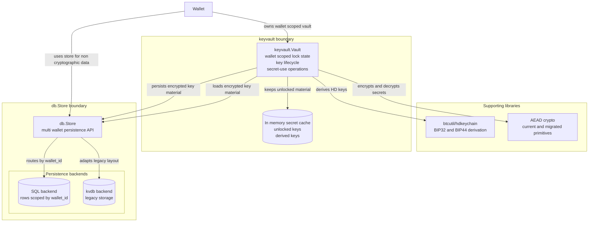

# ADR 0010: Keyvault Encryption Layer

## Status

- **Status:** Accepted
- **Date:** 2026-02-06

## Relationships

- **Amends:** None.
- **Supersedes:** None.
- **Amended by:** None.
- **Superseded by:** None.

## 1. Problem

The legacy `waddrmgr` design puts storage, lock state, key derivation, and
encryption in one component. This causes these problems:

- The SQL migration is harder.
- Encryption logic spreads across persistence code.
- Lock state is difficult to test alone.

The wallet needs one component that owns lock state, secret lifetime, key
derivation, and encryption. The database layer must stay encryption
agnostic and store encrypted key material as opaque bytes.

The component must also define how code uses a secret. Without such rules,
these problems occur:

- A secret stays in memory after `Lock` returns.
- A safe API gives a private key to caller code.
- A Store transaction and the vault wait for each other.

## 2. Context

ADR 0009 defines the single-passphrase encryption model. ADR 0007 proposes
new cryptographic primitives. Both need a clear boundary between wallet
domain logic and persistence. Other wallet code continues to use `db.Store`
for data that is not cryptographic.

The current code has these gaps in secret use:

- **Secrets leave the vault.** Wallet code calls `Vault.Decrypt` for private
  material. Then it derives, signs, and clears the key itself. The vault
  mutex covers only the `Decrypt` call. `mainLoop` runs `Lock` inline and
  runs signing requests concurrently. Thus `Lock` can return while a signer
  still holds a key.
- **Safe APIs give keys to caller code.** `Signer` and PSBT signing accept a
  `PrivKeyTweaker` callback. The wallet calls it with the derived key.
- **The lock order is inverted.** Account creation calls the vault inside a
  Store write transaction. `WalletVault.ChangePassphrase` calls the Store
  while it holds the vault mutex. On SQLite, a rotation that runs during
  account creation fails after the 5 second busy timeout.
- **Some parsers need strings.** `hdkeychain.NewKeyFromString` accepts only
  a `string`. Go code cannot erase a `string`.

Passphrase rotation re-wraps the crypto keys, but it does not change them.
Thus ciphertext made with the runtime keys stays valid after a rotation.

### Constraints

- The vault must not expose wallet ID parameters on its methods.
- A safe API must not return a private key or give one to caller code.
- A vault selector must not contain a SQL row ID, a kvdb adapter ID, or a
  wallet ID.
- A Store transaction and the vault must not wait for each other.
- Public-only derivation must work while the wallet is locked.
- Account creation must keep allocation, derivation, and persistence in one
  Store transaction.
- Go code cannot erase immutable strings or copies from the runtime or a
  library.
- Do not add a compare-and-swap or preparation protocol.
- Genesis secret lifetime and PSBT signing authorization are out of scope.

## 3. Decision

### 3.1 Package and Scope

The `wallet/internal/keyvault` package defines the encryption boundary
between wallet domain code and the Store.

Each `keyvault.Vault` belongs to exactly one wallet. During construction,
the vault receives a `db.Store` and a wallet ID. After that, the vault keeps
persistence routing internal. Callers do not pass a wallet ID to any vault
method.

Keyvault uses `db.Store` for persistence. It does not talk directly to SQL
backends.

The diagram shows structural boundaries. It does not show a runtime call
sequence.

The `Wallet` struct holds a vault for its wallet and a multi-wallet
`db.Store`. Encrypted key material goes through the vault. Other wallet data
can go directly through the Store.

### 3.2 Responsibilities

The vault owns these items:

1. **Lock state and secret lifetime.** The vault owns the unlocked runtime
   keys and clears secret memory.
2. **Every private-key use.** The vault derives private keys, signs, and
   computes ECDH. Wallet code does not hold a private key.
3. **HD derivation.** The vault uses `btcutil/hdkeychain` for BIP32 and
   BIP44 derivation.
4. **A secret cache.** While unlocked, the vault can cache account keys and
   derived keys. These keys are vault state, and `Lock` clears them.
5. **Encryption.** The vault follows ADR 0009. It adopts the ADR 0007
   primitives after their implementation.
6. **Coexistence with `waddrmgr`.** New code uses keyvault. Legacy code uses
   `waddrmgr` until the migration is complete.

The Wallet keeps everything that needs no private key:

- Transaction, PSBT, and script checks.
- Sighash and digest construction.
- Witness assembly and signature serialization.
- Public-only derivation and scripts that contain no secret.

The vault does not accept transactions, PSBTs, witnesses, or Taproot trees.

The Wallet or controller schedules the auto-lock timeout. This policy is not
part of the vault.

### 3.3 Operations

The vault has these typed operations for secret use:

1. **Sign a digest.** The modes are ECDSA, compact ECDSA, and BIP340
   Schnorr.
2. **Compute ECDH.** The vault computes `d*P` and hashes the 33-byte
   compressed point with SHA-256. It returns only the 32-byte digest. The
   point is a work copy.
3. **Derive an account.** The vault returns the extended public key, the
   encrypted private key, and the master key fingerprint.
4. **Encrypt new secret material,** such as an imported key or script.
5. **Decrypt a script** for `ScriptForOutput`. This is a copy exception.
6. **Export a private key** for `UnsafeSigner`. This is a copy exception.

Only operations 5 and 6 return a decrypted secret.

A signature can use a key transformation. The Wallet calculates a scalar
pair from public data, and the vault signs with `mul*d + add`. The vault
rejects a scalar that is out of range, a zero `mul`, and a zero result. The
vault must not log the pair.

### 3.4 Selectors

A selector names a key in the wallet of the vault. It uses one of these
forms:

- A key scope with an account name or a BIP44 account number.
- A BIP32 derivation path.
- A script pubkey.

A selector must not contain a SQL row ID, a kvdb adapter ID, or a wallet ID.
The vault resolves a selector through the Store before it takes its guard.

### 3.5 Lock

The vault has one operation guard:

1. An operation holds the guard from its lock check until it clears its
   work copies.
2. `Lock` takes the guard exclusively. Thus `Lock` waits for operations in
   progress.
3. After `Lock` returns, the vault holds no plaintext. A later operation
   returns `ErrVaultLocked`.
4. `Unlock` installs the full state or no state.

The guard is not reentrant. While an operation holds the guard, it must not
call a vault method, call the Store, submit a Wallet request, or run caller
code. The vault accepts no caller callbacks.

### 3.6 Lock Order

A Store transaction can take the vault guard. The vault guard must not wait
for the Store. Thus:

1. The vault does no Store call while it holds the guard.
2. Account derivation uses only the runtime keys. It needs no Store call
   inside the account transaction.
3. `Unlock` and passphrase rotation share a separate credential lock. No
   Store transaction waits for that lock. Thus `Unlock` cannot accept a
   passphrase that a rotation replaced.

Rotation does not change the crypto keys. Thus account creation and
rotation can run at the same time without an extra protocol. A change that
replaces the crypto keys needs a new ADR.

If `Lock` runs during account creation, the vault operation completes first
or returns `ErrVaultLocked`. In the second case, the Store transaction rolls
back and does not use the account number.

### 3.7 Ownership and Cleanup

The vault clears every secret that it creates before the operation returns.
This includes decrypted bytes, parsed keys, derived keys, transformation
copies, and shared points. `Lock` and wallet stop clear the runtime keys and
the cache.

Cleanup applies on success, error, and panic. The operation defers the
cleanup right after it creates each secret. The vault does not recover a
panic.

The caller owns these values:

- Passphrases and plaintext given to the vault.
- Signatures, public keys, and ECDH results.
- A private key from `UnsafeSigner`.
- A script from `ScriptForOutput`.

The last two are copy exceptions. The vault returns a new copy, and then it
has no control of that copy. `Lock` does not clear it.

Errors and logs must not contain keys, scalars, or plaintext scripts.

### 3.8 Strings

A vault operation can convert secret bytes to a `string` for a parser that
needs one, such as `hdkeychain.NewKeyFromString`. The operation must not
keep the string. It must clear the source bytes and the parsed result. The
garbage collector frees the string at an unknown time. Do not add other
string copies of secrets.

### 3.9 Public API

- A public API that returns a private key, or gives one to caller code, goes
  only on `UnsafeSigner`.
- Thus safe signing parameters must not have `PrivKeyTweaker`. Typed
  transformation data replaces it.
- `UnsafeSigner` gets no callback API.
- `Signer.ECDH` stays the only ECDH API.
- Signature types stay in package `wallet`. Vault types stay internal.

Some deprecated methods export keys or sign through `waddrmgr`. Examples are
`ComputeInputScript`, `PrivKeyForAddress`, `DumpPrivKeys`, and
`SignTransaction`. They stay as exceptions until kvdb removal. New methods
must not copy them.

Each consumer change decides if `LegacyWalletVault` supports a new
operation. If it does, it follows this contract.

## 4. Rationale

A vault for each wallet keeps wallet ID routing out of controllers,
accounts, addresses, and tests. A wallet ID on every call would also make a
cross-wallet mistake possible at every call site.

One owner for each secret makes `Lock` mean something. After `Lock`, no
vault secret stays in memory.

Typed operations keep keys inside the vault. A callback gives the key to
code that can keep it, log it, or call the vault again and block.

The Store already calls the vault inside its transactions. Thus Store, then
vault, is the only safe order.

Rotation already keeps the crypto keys, so an extra protocol adds no safety.

## 5. Alternatives Considered

### Alternative: Wallet ID on Every Vault Method

This moves database routing into every caller and allows cross-wallet
mistakes. Rejected.

### Alternative: Return Keys to Wallet Code

`Lock` cannot wait for keys that Wallet code holds. Rejected.

### Alternative: Vault Callback With a Private Key

The callback can keep the key, block on the guard, or call the Store.
Rejected.

### Alternative: Public Signing Package with Row-ID Locators

PR #1279 proposes a public `wallet/signing` package. This ADR agrees with
its digest-level signing and with Wallet ownership of transaction logic. It
rejects the `AccountID` row-ID locator, a second public signature type set,
and the Schnorr-only tweak.

### Alternative: Compare-and-Swap for Account Creation

Rotation does not change the crypto keys, so the check finds no conflict.
Rejected.

### Alternative: Vault Signs Transactions

The vault would need transaction and PSBT logic. Rejected.

## 6. Consequences

### Positive

- Database code stores opaque bytes. It knows nothing about cryptography,
  lock state, or key derivation.
- Wallet code works with typed results, not encrypted blobs.
- One component owns lock state and secret cleanup.
- `Lock` clears all vault secrets and waits for their use.
- No safe API gives a key to caller code.
- One lock order removes the SQLite rotation failure.
- Callers do not pass wallet IDs.
- Keyvault tests can use mock stores. Wallet tests can use mock vaults.
- Each wallet has its own vault, lock state, cache, and secret lifetime.
- New SQL paths can move behind the vault before the removal of legacy
  paths.

### Negative and Risks

- The new package boundary needs maintenance.
- Existing code paths need a refactor to use the vault.
- `waddrmgr` and keyvault coexist during the migration.
- Implementations must keep wallet ID routing in constructors, adapters, or
  Store methods.
- The vault gets one operation for each kind of secret use.
- `Lock` can wait for a slow operation.
- `PrivKeyTweaker` callers must change.
- Deprecated exports and caller-owned copies stay outside vault control.

## 7. Implementation Overview

- `wallet/internal/keyvault` gets the typed operations and the guard.
- `ChangePassphrase` and `Unlock` move their Store calls out of the guard.
- Wallet signing, ECDH, account creation, and `ScriptForOutput` call vault
  operations, not `Decrypt`.
- Tests show that `Lock` waits, that cleanup runs on panic, and that
  rotation and account creation both succeed on SQLite.

## 8. References

- [ADR 0001: Multi-Wallet Architecture](0001-multi-wallet-architecture.md)
- [ADR 0007: XChaCha20-Poly1305
  Encryption](0007-xchacha20-poly1305-encryption.md)
- [ADR 0009: Single-Passphrase Encryption
  Model](0009-single-passphrase-encryption.md)
- PRs [#1279](https://github.com/btcsuite/btcwallet/pull/1279),
  [#1437](https://github.com/btcsuite/btcwallet/pull/1437), and
  [#1485](https://github.com/btcsuite/btcwallet/pull/1485).
