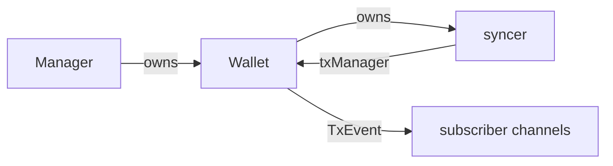

# ADR 0016: Wallet Transaction Subscriptions

## Status

- **Status:** Accepted
- **Date:** 2026-10-17

## Relationships

- **Amends:** None.
- **Supersedes:** None.
- **Amended by:** None.
- **Superseded by:** None.

## 1. Problem

Wallet clients need confirmed and unconfirmed transaction events without slow
subscribers blocking transaction operations or changing their results.

## 2. Context

`Manager` owns Wallet lifecycle. `Wallet` implements `TxReader`, `TxWriter`,
and `TxPublisher`; its syncer records chain observations. `TxDetail` already
provides the wallet-relative transaction data clients need.

### Constraints

- Apply the same contract to kvdb, SQLite, and PostgreSQL.
- Preserve persistence, publication, rollback, and shutdown ownership.
- Delivery is best effort, with no replay or transaction-ordering guarantee.

## 3. Decision

Each Wallet stores its subscriber map and mutex directly and implements
registration, cancellation, and notification. Successful publication and
committed syncer writes invoke the Wallet's notifier. Preparation failure
skips the event without changing the operation's result.

The syncer receives one private `txManager` interface embedding the existing
`TxPublisher` and `txNotifier` roles. Wallet implements it; no separate
transaction manager object or lifecycle is introduced.

`Wallet` implements `TxSubscriber`; `SubscribeTxns` returns an event channel
and cancellation function.
Explicit cancellation discards queued events and closes the channel before
returning. Caller-context completion and Wallet shutdown also end the stream.
Use existing Wallet request admission and shutdown to own these lifetimes.

Prepare each `TxEvent` once from committed `TxDetail` and observation time,
then copy mutable data per subscriber. Block information distinguishes
confirmed and unconfirmed events. Each channel retains at most 1,000 events;
overflow discards the oldest and keeps the incoming event without ending the
subscription. Retained events are FIFO, and sends never wait for consumers.

One mutex coordinates membership, sends, and closure. Database reads and detail
conversion remain outside it. Late registration can miss events; callers should
subscribe before initiating work.

## 4. Rationale

Wallet already owns identity, configuration, reads, and request admission.
Keeping subscription methods there avoids copying those dependencies into
another owner. The private interface limits the syncer's access, while shared
detail conversion avoids backend-specific payloads. One map and mutex
coordinate channels; cancellation reuses Wallet's existing request loop.

## 5. Alternatives Considered

### Alternative: Store interception and transaction tracking

A Store decorator captures transaction state before batch writes and compares
committed results afterward. An in-memory notifier tracks pending confirmations
and publication attempts to decide which changes to deliver. This adds write
coordination and transaction history tracking to notifications. Best-effort
observations need only the existing successful producer boundaries, so this
coupling and bookkeeping are unnecessary.

### Alternative: Transaction mutation and publication coordinator

A separate processor borrows Wallet operations through callbacks, gates
mutations, and coordinates concurrent publication attempts before delivery.
This centralizes ordering but also makes the processor responsible for writes
and publication that Wallet and syncer already handle. The chosen contract
requires no transaction ordering, so retaining those responsibilities and
adding direct Wallet notification is a smaller change.

## 6. Consequences

### Positive

Wallet owns subscriber state and lifetime using its existing dependencies.
Slow consumers and preparation failures do not change transaction results;
syncer accesses publication and notification through one private interface.

### Negative and Risks

Events may be lost, repeated, or delivered out of transaction order. There is no
snapshot, replay, all-status feed, or complete reorg history; query Wallet for
current state. Subscriber count is uncapped, so total memory and fan-out work
grow despite bounded individual queues. Explicit cancellation may wait for
other Wallet control requests.

Incoming unconfirmed events depend on the chain backend's mempool feed, which
Neutrino does not provide. Local publication and confirmed chain observations
remain available across all supported backends.

## 7. Implementation Overview

Reuse the committed transaction-detail mapper and publication/syncer hooks.
Wallet methods use its existing Store, identity, and chain configuration.
Database schemas, chain coordination, and lnd/RPC changes remain out of scope.

Verify wallet isolation, confirmed/unconfirmed payloads, drop-oldest FIFO,
cancellation/shutdown races, and preservation of operation results.

## 8. References

- [Engineering Guide](../ENGINEERING_GUIDE.md)
- [ADR 0015](0015-sql-shared-chain-ownership.md)
