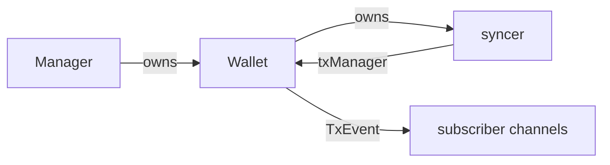

# ADR 0016: Wallet Transaction Subscriptions

## Status

- **Status:** Accepted
- **Date:** 2026-10-17

## Relationships

- **Amends:** None.
- **Supersedes:** None.
- **Amended by:** None.
- **Superseded by:** None.

## 1. Problem

Wallet clients need confirmed and unconfirmed transaction events without slow
subscribers blocking transaction operations or changing their results.

## 2. Context

`Manager` owns Wallet lifecycle. `Wallet` implements `TxReader`, `TxWriter`,
and `TxPublisher`. The syncer of each Wallet records chain observations.
`TxDetail` already provides the wallet-relative transaction data that clients
need.

### Constraints

- Apply the same contract to kvdb, SQLite, and PostgreSQL.
- Preserve persistence, publication, rollback, and shutdown ownership.
- Delivery is best effort, with no replay or transaction-ordering guarantee.

## 3. Decision

Each Wallet stores its subscriber map and mutex directly and implements
registration, cancellation, and notification. Successful publication and
committed syncer writes invoke the Wallet's notifier. If event preparation
fails, the Wallet skips the event. The preparation failure does not change the
operation's result.

The syncer receives one private `txManager` interface that embeds the existing
`TxPublisher` and `txNotifier` roles. Wallet implements `txManager`. The
design introduces no separate transaction manager object or lifecycle.

`Wallet` implements `TxSubscriber`. `SubscribeTxns` returns an event channel
and a cancellation function. Explicit cancellation discards queued events and
closes the channel before returning. Caller-context completion and Wallet
shutdown also end the stream. Use existing Wallet request admission and
shutdown to own these lifetimes.

Prepare each `TxEvent` once from the committed `TxDetail` and the observation
time. Then copy mutable data for each subscriber. Block information
distinguishes confirmed events from unconfirmed events. Each channel retains
at most 1,000 events. On overflow, the channel discards the oldest event and
keeps the incoming event. Overflow does not end the subscription. Retained
events are FIFO. Sends never wait for consumers.

One mutex coordinates membership, sends, and closure. Database reads and
detail conversion remain outside the mutex. A late registration can miss
events. Callers should subscribe before they start work.

## 4. Rationale

Wallet already owns identity, configuration, reads, and request admission.
When the subscription methods stay in Wallet, those dependencies are not
copied into another owner. The private interface limits the syncer's access.
Shared detail conversion avoids backend-specific payloads. One map and one
mutex coordinate channels. Cancellation reuses the existing Wallet request
loop.

## 5. Alternatives Considered

### Alternative: Store interception and transaction tracking

A Store decorator captures transaction state before batch writes and compares
the committed results after the writes. An in-memory notifier tracks pending
confirmations and publication attempts to decide which changes to deliver.
This alternative adds write coordination and transaction history tracking to
notifications. Best-effort observations need only the existing successful
producer boundaries. Thus, this coupling and bookkeeping are unnecessary.

### Alternative: Transaction mutation and publication coordinator

A separate processor borrows Wallet operations through callbacks, gates
mutations, and coordinates concurrent publication attempts before delivery.
This alternative centralizes ordering. But the processor also becomes
responsible for writes and publication that Wallet and syncer already handle.
The chosen contract requires no transaction ordering. Thus, it is a smaller
change to keep those responsibilities and add direct Wallet notification.

## 6. Consequences

### Positive

Wallet owns subscriber state and lifetime with its existing dependencies.
Slow consumers and preparation failures do not change transaction results.
The syncer accesses publication and notification through one private
interface.

### Negative and Risks

Events may be lost, repeated, or delivered out of transaction order. The design
provides no snapshot, replay, all-status feed, or complete reorg history. To
get the current state, query Wallet. The subscriber count has no cap. Thus,
total memory and fan-out work grow, although each individual queue is bounded.
Explicit cancellation may wait for other Wallet control requests.

Incoming unconfirmed events depend on the mempool feed of the chain backend.
Neutrino does not provide this feed. Local publication and confirmed chain
observations remain available on all supported backends.

## 7. Implementation Overview

Reuse the committed transaction-detail mapper and publication/syncer hooks.
Wallet methods use the existing Store, identity, and chain configuration of
the Wallet. Database schemas, chain coordination, and lnd/RPC changes remain
out of scope.

Verify these behaviors:

- Wallet isolation.
- Confirmed/unconfirmed payloads.
- Drop-oldest FIFO.
- Cancellation/shutdown races.
- Preservation of operation results.

## 8. References

- [Engineering Guide](../ENGINEERING_GUIDE.md)
- [ADR 0015](0015-sql-shared-chain-ownership.md)
