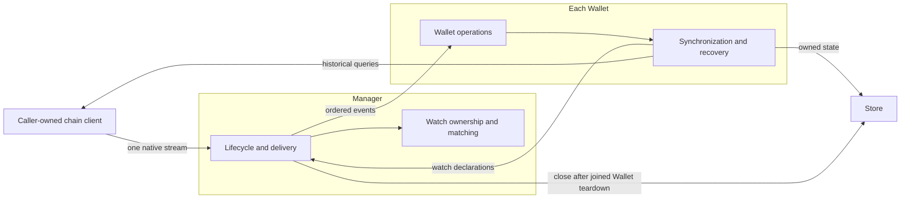

# ADR 0017: Manager Chain Routing

## Status

- **Status:** Proposed
- **Date:** 2026-11-17

## Relationships

- **Amends:** [ADR 0006](0006-wtxmgr-sql-schema.md) for Wallet-owned block
  identity and references, and [ADR 0015](0015-sql-shared-chain-ownership.md)
  for live routing, registration, publication watch readiness and Wallet-owned
  history and rollback.
- **Supersedes:** None.
- **Amended by:** None.
- **Superseded by:** None.

## 1. Problem

Wallets share a native notification stream but own separate processing and
history. Delivery must retain source order and early payments without coupling
one Wallet's recovery to every other Wallet.

## 2. Context

Manager owns membership and aggregate lifetime. Each Wallet owns its
synchronization, transactions, checkpoint and historical recovery. The caller
owns the chain client's connection.

## 3. Decision

Manager consumes one native stream, records watch ownership and matches
transactions. It delivers bounded, ordered work through the Wallet boundary.
Standalone transactions go only to interested Wallets. Filtered blocks reach
every published Wallet, even without matching transactions. Header-only
notifications wake historical catch-up. Each Wallet owns its processing and
recovery.

SQL Start and Create establish live watches before publishing a Wallet.
Manager records watch ownership before native activation can emit observations.
Historical catch-up proceeds independently of publication, and each Wallet
owns its scoped historical scans. KVDB retains its background initialization.

SQL block observations are keyed by Wallet and height. Confirmation, birthday
and checkpoint references carry the same Wallet identity.

Disconnects follow ordinary ordered delivery. Each Wallet's existing worker
atomically rewinds its history and discards stale fetched work. It clears
affected confirmations and orphans disconnected coinbases before deleting
their block rows. Canonical observations below the disconnect are preserved
even when the saved checkpoint lags. Wallets can advance at different heights
without a shared frontier, writer barrier or recovery queue.

Registration must progress during blocked delivery. Stop joins owned work
before closing Store and leaves the borrowed chain connection running.
Closure of the native stream triggers the same joined shutdown. An
indeterminate write terminates retry and requires aggregate shutdown.

## 4. Rationale

Ownership follows the component that can prove completion. Manager orders
shared input. Wallet keeps its persistence and recovery local. Storage scope
prevents one Wallet's rewind from changing another Wallet's committed state.

## 5. Alternatives Considered

### Independent readers or broadcast-and-filter

Competing readers cannot broadcast one channel. Repeating matching in every
Wallet also duplicates work and cannot use queued funding observations once.

### Shared history with Manager-wide reconciliation

Shared history with independently advancing Wallets requires aggregate
recovery coordination. Wallet-owned history avoids that extra protocol at the
cost of duplicated block metadata. Local fork detection remains necessary.

### Forwarding workers or unbounded queues

These add lifetime and scheduling policy. Existing workers and bounded
backpressure provide the required ordering.

## 6. Consequences

- Independent Wallet recovery duplicates block metadata across Wallets.
- A slow Wallet can backpressure the shared reader.
- Retained orphan observations above a canonical checkpoint remain a separate
  recovery concern.

## 7. Implementation Overview

Use the existing component loops, persistence transactions and joined teardown.
Keep matching private to Manager and processing private to Wallet.
The [SQL preparation](0006-wtxmgr-sql-schema.md#24-implementation-overview)
leaves shared rollback active. The runtime cutover adopts ordered disconnect
delivery and Wallet-local rewind together.

## 8. References

- [ADR 0015: Manager lifecycle and SQL shared-chain
  ownership](0015-sql-shared-chain-ownership.md).
- [ADR 0006: SQL schema](0006-wtxmgr-sql-schema.md).
- [ADR 0004: Targeted recovery](0004-targeted-rescan-vs-rewind.md).
