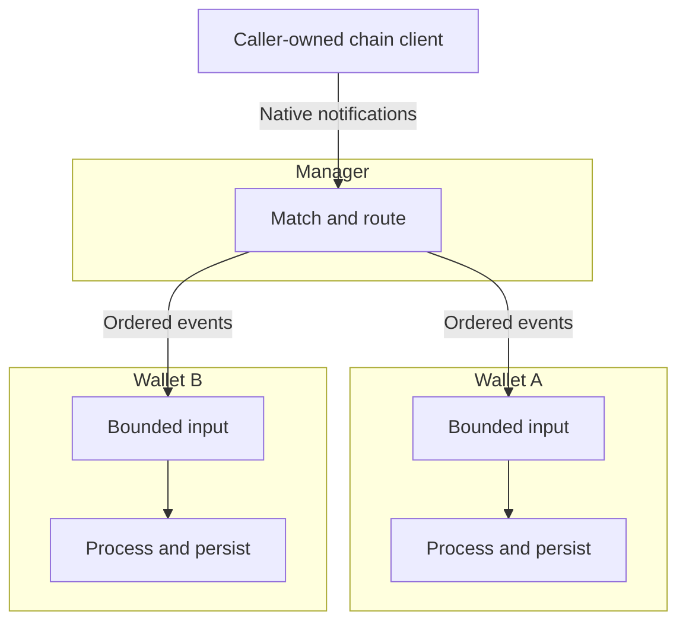

# ADR 0017: Manager Chain Routing

## Status

- **Status:** Proposed
- **Date:** 2026-11-17

## Relationships

- **Amends:** [ADR 0015](0015-sql-shared-chain-ownership.md), section 3.4's
  live-matching ownership and the startup watch-readiness boundary.
- **Supersedes:** None.
- **Amended by:** None.
- **Superseded by:** None.

## 1. Problem

SQL Wallets share one native notification stream. Independent readers compete
for events; broadcasting every transaction repeats parsing and relevance work
in each Wallet. Manager must select recipients before their workers persist
the transactions, while retaining early payments and source order.

Publication must establish SQL live watches while each Wallet catches up
independently. A successful Start or Create does not promise completed
historical recovery.

## 2. Context

Manager owns membership, the native reader, shared rollback and Store
lifetime. Wallet owns its request loop, processing worker and committed tip.
Stored addresses and outputs reconstruct live interests; matching also learns
queued funding outputs before their Wallet has committed them.

### Constraints

- Borrow the caller's running chain client without starting or stopping it.
- Keep existing workers, bounded Wallet input and source ordering.
- Serialize mutable watch ownership with native routing in Manager.
- Preserve native subscription results, scoped scans and per-Wallet checkpoints.
- Preserve KVDB's single-Wallet isolation and background initialization.
- Assume aligned committed Wallet checkpoints for shared startup.

## 3. Decision

Manager and Wallet are the two component owners. Their loops are internal
mechanisms, and each owner's helpers remain private.

Manager owns native input, published membership, watch ownership and shared
rollback. Wallet owns transaction persistence, synchronization, retry, scoped
scans and its workers. Cross-component operations go through the owner;
children receive only the services they need.

SQL Start and Create prepare Wallet state and install persisted address/outpoint
interests before activating and publishing the Wallet. The native source keeps
early observations until delivery can begin. Historical catch-up remains
independent of publication. KVDB retains background watch initialization.

Manager records watch ownership before native subscription activation can emit
an event. Wallet-initiated subscription I/O remains part of the calling
Wallet's owned work, with the backend's actual completion and error semantics.
Later initialization and committed scans refresh interests through the same
owner boundary. Interests remain registered after a spend so replacement and
reorg spends stay routable; watched addresses can also receive again.

Manager matches transactions once and delivers immutable prepared events in
source order. Matching learns funding outpoints before later records can spend
them. Each transaction observation reaches each interested Wallet once.
Filtered blocks reach every published Wallet, even without matching
transactions; header-only notifications wake historical catch-up. Bounded
Wallet input applies backpressure; Manager must still accept the control work
that lets a blocked Wallet make progress.

For a native disconnect, Manager pauses Wallet writers, waits for earlier
writes, rewinds shared storage once, then resumes processing. Wallet creation
and Store closure wait for the rewind to settle. Any rewind error, including
an uncertain commit, stops all Wallets before writers resume. Wallet request
handling remains available during the pause.

An uncertain write terminates retry: Wallet reports the error and finishes its
worker, and Manager joins owned work before closing storage. Closure of the
required notification stream also stops Manager. Normal Stop uses the same
joined disposal. The borrowed chain connection remains caller-owned.

## 4. Rationale

Manager owns source order, so it can serialize watch changes without
cross-owner locking. Installing ownership before native activation prevents a
delivery gap. Keeping native I/O in the Wallet's owned work avoids blocking the
Manager loop on an uncancelable backend call. Control progress during delivery
and pause waits prevents a Wallet from waiting behind its own worker.

## 5. Alternatives Considered

### Independent SQL backend readers

Competing receives cannot broadcast one source channel to several Wallets.

### Broadcast all transactions and match in each Wallet

Each Wallet repeats parsing and relevance work that Manager can perform once.

### Caller-fed fanout with Wallet filtering

The [caller-fed proposal](https://github.com/btcsuite/btcwallet/pull/1434)
leaves source consumption and delivery with the caller and repeats filtering
in each Wallet. Manager-owned consumption and watch declarations put recipient
selection beside source ordering while Wallets retain persistence and recovery.

### Query Store for recipients at delivery

A funding transaction can still be queued when its spend arrives. Durable
ownership cannot identify that spend's recipient before the funding commits.

### Share routing state with Wallet

This mixes matching, subscription and aggregate lifecycle responsibilities and
requires synchronization outside the owner loop.

### Block Manager control work during delivery

A worker can need registration before draining its input. Manager must preserve
ordered delivery while allowing that registration to complete.

### Add a forwarding worker or unbounded recipient queues

These add lifecycle and scheduling policy without removing the need to order
writes and rollback. Existing bounded input and joined workers suffice.

## 6. Consequences

### Positive

- SQL publication establishes live interests before historical catch-up.
- Routing and aggregate failure policy stay inside Manager.
- Wallet retains processing, retry, scans and worker disposal.

### Negative and Risks

- A slow Wallet backpressures the shared reader, and retained watch interests
  accumulate for the Manager lifetime.
- Native RPCs without cancellation must finish before owned work can be joined.
- Aligned-checkpoint startup does not define recovery from unequal checkpoints
  or retained orphan history.

## 7. Implementation Overview

Manager coordinates subscription ownership, routing and shared rollback.
Wallet startup supplies persisted interests before processing is activated;
subsequent synchronization refreshes them through Manager. Wallet continues to
own processing and retry, while Manager joins Wallet disposal before releasing
shared storage.

## 8. References

- [ADR 0015: Manager Lifecycle and SQL Shared-Chain
  Ownership](0015-sql-shared-chain-ownership.md).
- [ADR 0004: Targeted Rescan vs. Global
  Rewind](0004-targeted-rescan-vs-rewind.md).
- [ADR 0005: Explicit Rescan on Import](0005-no-auto-rescan-on-import.md).
- [Scanning and synchronization](../scanning_sync_architecture.md).
