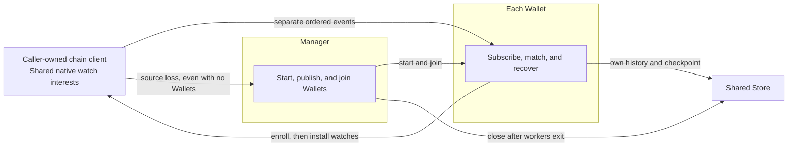

# ADR 0017: Direct Wallet Chain Subscriptions

## Status

- **Status:** Proposed
- **Date:** 2026-11-17

## Relationships

- **Amends:** [ADR 0006](0006-wtxmgr-sql-schema.md) for Wallet-owned block
  identity and references, and [ADR 0015](0015-sql-shared-chain-ownership.md)
  for direct Wallet subscriptions, publication watch readiness and
  Wallet-owned history and rollback.
- **Supersedes:** None.
- **Amended by:** None.
- **Superseded by:** None.

## 1. Problem

Wallets need ordered chain events to advance separate checkpoints and recover
independently. Installing a watch can produce an immediate observation, so the
Wallet needs a way to receive it before the watch takes effect.

## 2. Context

The caller owns one chain client and its connection. Manager reads the native
notification stream, uses its chain syncer to match events, and forwards work
to Wallets. Manager also owns membership, shared rollback and Store lifetime.
Each Wallet owns its processing, transactions, checkpoint and historical
recovery.

### Constraints

- The caller owns the chain client's lifetime.
- Each Wallet receives events in source order and enrolls before installing
  its watches.
- KVDB keeps its isolated single-Wallet scope and background initialization.
  See [ADR 0015](0015-sql-shared-chain-ownership.md#36-lease-and-scope).

## 3. Decision

The chain client supplies a separate ordered stream to each Wallet and shares
native address and outpoint watch interests across subscriptions. Each Wallet
enrolls in its stream before installing those watches and matches its own
transactions. Filtered blocks advance it even when no transaction matches.
Header-only notifications wake its historical catch-up.

Manager starts, publishes and joins Wallets. SQL Start and Create publish a
Wallet after its stream enrollment and watch installation. Historical catch-up
proceeds independently of publication. Manager observes source loss even with
no active Wallets. On Stop or source loss, it stops and joins Wallet workers
before closing Store. The chain client stays with its caller.

SQL block observations are keyed by Wallet and height. Confirmation, birthday
and checkpoint references carry the same Wallet identity. The Wallet worker
advances its checkpoint in stream order and atomically rewinds its own history
on disconnect. It clears affected confirmations and orphans disconnected
coinbases before deleting their block rows, then discards stale fetched work.
Canonical observations below the disconnect remain valid even when the saved
checkpoint lags. Indeterminate writes follow the aggregate shutdown policy.

## 4. Rationale

Direct subscriptions keep enrollment and matching with the Wallet that owns
the watches, while the chain client shares the native subscriptions. Local
history lets Wallets progress at different heights and limits each rewind to
one Wallet. Manager keeps aggregate lifecycle and Store ownership.

## 5. Alternatives Considered

### Keep Manager as the single reader

Native notifications arrive on one channel. Multiple readers would compete
for events. Manager reads the channel once and forwards work to bounded
Wallet inboxes. This preserves source order and avoids repeated matching.
A full inbox can stall forwarding.

### Shared history with Manager-wide reconciliation

A shared history required aggregate coordination to rewind independently
advancing Wallets. Wallet-owned history removes that coordination at the cost
of duplicating block metadata. Each Wallet still needs local fork detection.

### Shared block tree keyed by hash

A shared table can retain competing blocks at the same height while
each Wallet rewinds its own references. A Wallet can observe a block
before its parent is known or before its checkpoint reaches that
height. The tree would still need Wallet-local observations to recover
that history. Those rows and indexes reduce the storage savings, and
reading block metadata from them adds a join.

## 6. Consequences

### Positive

- Each Wallet matches events and recovers independently. Its rewind affects
  only its own history.

### Negative and Risks

- Matching an event in more than one Wallet can repeat filtering work.
- With bounded delivery at the shared chain client, a full Wallet mailbox can
  delay later events for other Wallets.
- Storage grows with the sum of the Wallets' retained block histories.
  Wallets retaining the same range each store its block metadata and
  indexes. Recovery of retained orphan observations above a canonical
  checkpoint remains a separate concern.

## 7. Implementation Overview

The [SQL schema](0006-wtxmgr-sql-schema.md#24-implementation-overview)
includes storage for Wallet-owned block history. Manager still coordinates
shared rollback.

Runtime adoption requires a separate ordered stream for each Wallet and a
source-loss signal for Manager. Block references and rollback move to the
owning Wallet together.

## 8. References

- [ADR 0015: Manager lifecycle and SQL shared-chain
  ownership](0015-sql-shared-chain-ownership.md).
- [ADR 0006: SQL schema](0006-wtxmgr-sql-schema.md).
- [ADR 0004: Targeted recovery](0004-targeted-rescan-vs-rewind.md).
