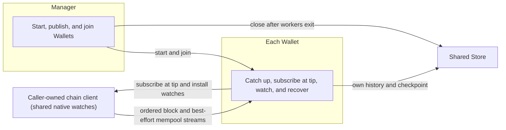

# ADR 0017: Direct Wallet Chain Subscriptions

## Status

- **Status:** Accepted
- **Date:** 2026-11-28

## Relationships

- **Amends:** [ADR 0006](0006-wtxmgr-sql-schema.md) for Wallet-owned block
  identity and references, and [ADR 0015](0015-sql-shared-chain-ownership.md)
  for direct Wallet subscriptions, sync-lifecycle watch ownership, and
  Wallet-owned history and rollback.
- **Supersedes:** None.
- **Amended by:** None.
- **Superseded by:** None.

## 1. Problem

Wallets need ordered chain events to advance separate checkpoints and recover
independently without blocking each other or overloading bounded live delivery
during historical catch-up. Installing a watch can also race with block arrival
or concurrent address creation, so each Wallet needs a gap-free handoff between
historical catch-up and live streaming.

## 2. Context

The caller owns one chain client and its connection. Previously, Manager read
the single native notification stream, matched events in a shared router, and
forwarded work to Wallets. Manager also owns Wallet membership and Store
lifetime. Each Wallet owns its processing, txns, checkpoint, and historical
recovery.

### Constraints

- The caller owns the chain client's lifetime and any legacy notification
  drain.
- Each Wallet receives strictly ordered block lifecycle events independently of
  unconfirmed mempool traffic.
- A slow or catching-up Wallet must not stall or disconnect sibling Wallets.
- KVDB keeps its isolated single-Wallet scope and background initialization.
  See [ADR 0015](0015-sql-shared-chain-ownership.md#36-lease-and-scope).

## 3. Decision

The chain client supplies per-Wallet subscriptions and shares native address
and outpoint watch interests across active subscriptions, releasing a
subscription's interests when it closes. Each subscription separates two
bounded streams:

- An **ordered block stream** delivers connected and disconnected block
  notifications in chain order. If a subscriber's block buffer overflows, the
  chain client retires only that subscription so sibling Wallets are never
  stalled.
- A **best-effort mempool stream** delivers unconfirmed tx notifications. Under
  mempool bursts, excess notifications are dropped rather than delaying or
  closing the ordered block stream.

Each Wallet scopes its live subscription to the synced phase rather than
holding it open across backend sync, large-gap historical catch-up, retry
backoff, or full rewind:

- Small-gap catch-up while already synced and targeted rescans retain the
  active live subscription and refresh watches on commit; if the block stream
  overflows during such a scan, the Wallet discards the stale batch and
  self-heals through overflow recovery.
- When historical catch-up reaches the chain tip, the Wallet opens a
  subscription, installs its persisted watch set, and confirms tip continuity
  and subscription liveness before entering the synced state.
- New watch registrations apply directly to the active subscription when
  synced. When unsynced, they invalidate any in-flight catch-up snapshot so
  historical scanning reloads persisted addresses before advancing the
  checkpoint. Pre-existing history for imported keys continues to follow
  [ADR 0005](0005-no-auto-rescan-on-import.md).
- On block-stream overflow, the affected Wallet closes its retired
  subscription, reconciles any fork, catches up missed blocks historically, and
  re-subscribes. Unexpected non-overflow closure triggers normal retry backoff.

Manager starts, publishes, and joins Wallets without routing chain events or
draining the legacy notification stream. On stop, Manager stops and joins all
Wallet workers before closing Store. The chain client stays with its caller.

SQL block observations are keyed by Wallet and height. Confirmation, birthday,
and checkpoint references carry the same Wallet identity. Each Wallet advances
its checkpoint in stream order, verifies parent continuity on live blocks, and
atomically rewinds its own history on disconnect. Canonical observations below
a disconnect remain valid even when the saved checkpoint lags.

## 4. Rationale

Scoping live subscriptions to the synced phase eliminates bounded-buffer
pressure during initial block download, large-gap catch-up, and full rescans
while keeping watch installation gap-free at the tip handoff. Separating
ordered block delivery from best-effort mempool delivery prevents mempool
spikes from forcing block resyncs. Invalidating in-flight catch-up snapshots on
concurrent address registration prevents missed payments without holding
pre-sync subscriptions or blocking address creation. Wallet-owned history lets
Wallets advance and rewind independently without Manager-wide coordination.

## 5. Alternatives Considered

### Keep Manager as the single reader

Native notifications arrive on one shared stream. Reading once in Manager and
forwarding to bounded Wallet inboxes requires central routing and couples slow
Wallets to the shared dispatch loop.

### Keep subscriptions open for the full Wallet lifetime

Enrolling a subscription during startup before backend sync and historical
catch-up forces buffering and draining across catch-up, retry backoff, and full
rewinds, and requires Manager to tear down overflowed Wallets instead of
letting each Wallet self-heal through catch-up.

### Shared history with Manager-wide reconciliation

A shared history required aggregate coordination to rewind independently
advancing Wallets. Wallet-owned history removes that coordination at the cost
of duplicating block metadata, while each Wallet still handles local fork
detection.

### Shared block tree keyed by hash

A shared table can retain competing blocks at the same height while each Wallet
rewinds its own references, but Wallets still need Wallet-local observations to
recover out-of-order history, reducing storage savings and adding joins.

## 6. Consequences

### Positive

- Each Wallet matches events, manages its own subscription lifecycle, and
  recovers independently. A rewind or block-stream overflow affects only that
  Wallet and self-heals through historical catch-up.
- Initial block download, large-gap historical catch-up, and full rescans run
  with zero live subscription buffer pressure.
- Mempool bursts drop best-effort notifications without disrupting ordered
  block processing.

### Negative and Risks

- Matching an event in more than one Wallet can repeat filtering work.
- Storage grows with the sum of the Wallets' retained block histories.
- Before callers activate the legacy notification API, the client retains only
  a small bounded batch of startup notifications and drops later legacy
  entries; callers that opt into the legacy API remain responsible for draining
  it.

## 7. Implementation Overview

- **Chain layer**: Provides per-Wallet split block/mempool subscriptions,
  shared reference-counted watch indices, and independent legacy notification
  handling.
- **Wallet layer**: Removes Manager's shared router and legacy notification
  drain; each Wallet's sync worker owns sync-scoped subscription lifecycle,
  stale-snapshot watch reloads, split event handling, and self-healing overflow
  recovery.
- **Storage layer**: Stores Wallet-scoped SQL block observations,
  confirmations, and checkpoints with atomic per-Wallet rewind.

## 8. References

- [ADR 0015: Manager lifecycle and SQL shared-chain
  ownership](0015-sql-shared-chain-ownership.md).
- [ADR 0006: SQL schema](0006-wtxmgr-sql-schema.md).
- [ADR 0005: No auto-rescan on import](0005-no-auto-rescan-on-import.md).
- [ADR 0004: Targeted recovery](0004-targeted-rescan-vs-rewind.md).
