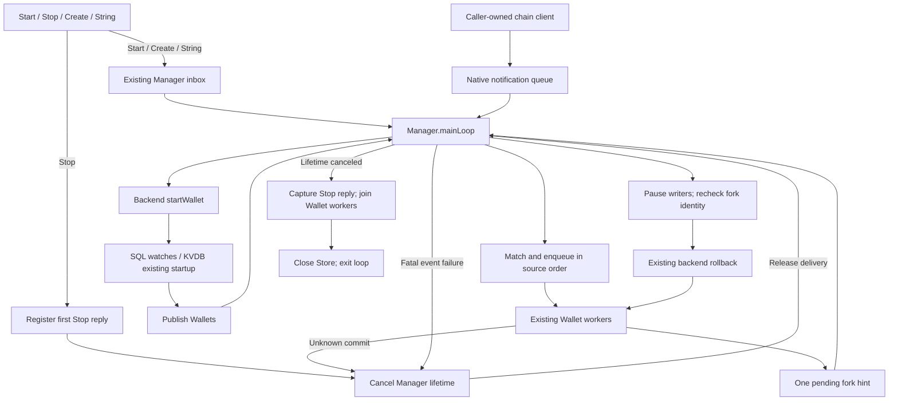

# ADR 0017: Manager Chain Routing

## Status

- **Status:** Proposed
- **Date:** 2026-10-26

## Relationships

- **Amends:** [ADR 0015](0015-sql-shared-chain-ownership.md), sections 3.4–3.6's
  matching, registration readiness, recovery and borrowed-source ownership.
- **Supersedes:** None.
- **Amended by:** None.
- **Superseded by:** None.

## 1. Problem

Several SQL Wallets share one backend notification stream. Independent readers
compete for events instead of each receiving its relevant transactions and
block progress. Forwarding every transaction to every Wallet repeats parsing
and relevance work. Manager needs enough information to select recipients
before their independently scheduled workers persist the transactions.

## 2. Context

Manager already owns aggregate lifecycle, the Wallet registry, shared SQL
storage, and the notification stream borrowed from the caller. Wallet owns
its joined worker lifetime. The syncer owns transaction persistence,
synchronization status, catch-up, and explicit scans.

Wallets already declare address and outpoint interests during address delivery,
publication, synchronization initialization, and committed-scan refresh. Stored
addresses and ListOutputsToWatch reconstruct those interests, including outputs
spent by unmined transactions. These mechanisms can supply routing ownership
without live-event Store reads or another recovery cache.

### Constraints

- Preserve asynchronous Wallet initialization, retry, and backend ordering.
- Install routing ownership before a successful native subscription can emit.
- A watched address or outpoint can belong to several Wallets.
- Preserve source order and bounded, lossless admission for each live target.
- Keep native receives on the Manager lifecycle loop; kvdb retains one
  Wallet per database and its existing address allocation behavior.
- Preserve native backend semantics rather than inventing uniform SPV mempool
  or subscription guarantees.

## 3. Decision

Manager's existing `mainLoop` serializes lifecycle requests, native source
receives, routing and shared rollback. Its existing wait group joins that loop.
The private `chainSyncer` keeps subscriptions, matching and an additive watch
registry; it has no reader or lifecycle of its own. Each Wallet retains its
worker, committed checkpoint, background catch-up and explicit scans.

Wallet starts and joins one `syncer.run` lifetime. The syncer owns initialization,
single attempts, retry timing and mailbox processing during backoff. Wallet
reports terminal results to Manager, without a second retry loop or event path.
The retry wait keeps its original deadline while servicing ordered observations
and rollback barriers.

A Wallet registration identifies its Wallet ID and addresses or outpoints.
Manager records the association before calling the existing backend method,
without holding routing locks during I/O. Success means that native method
succeeded. Failure remains with the existing caller or processor retry; an
already recorded association never suppresses a retry. The registry indexes
each address or outpoint to its set of Wallet owners, allowing direct event
lookups and shared interests without scanning each Wallet. Its short mutex
protects the mutable sets; parsing, native I/O and delivery happen outside it.

Manager parses transaction output addresses once and unions recipients from
matching outputs and watched inputs. Input script addresses also match before
recovery learns their funding outpoints; they remain separate from output
credit metadata. A transaction reaches each interested Wallet once. Matching
outputs become watched outpoints before the next record or event is matched,
so a queued parent's spend remains routable before the
parent commits. Learned interests remain additive for replacement spends.
Store still determines account and credit ownership transactionally.

Events carry immutable prepared matches and original notification metadata.
Each Wallet has a capacity-one mailbox feeding its existing worker. An actual
filtered block reaches every current Wallet, including those with no matching
transactions. Header-only block notifications retain their wakeup meaning:
catch-up scans recovery-window addresses before advancing the checkpoint.
Control events other than disconnects use ordinary Wallet handlers.

The loop delivers to its current published Wallet set in source order. Start
and Create run on that same owner and publish only after backend preparation.
SQL reuses Wallet startup and stored address/outpoint watch registration,
including block notifications. KVDB retains asynchronous initialization for
its isolated single Wallet. Neither backend waits for historical catch-up or
promises that its Wallet has reached the current tip before returning.

Native btcd, bitcoind and Neutrino clients retain unread notifications in their
existing queues. Events emitted during SQL watch preparation remain there
until the loop returns to receiving, after publication. Start replies before
the loop acquires the native notification channel. Create returns after its
prepared Wallet joins membership. No forwarding reader, extra native-event
buffer, or startup mempool reconciliation protocol is needed. Delivery retains
the backend's own subscription guarantees, including SPV limitations.

Live disconnects and background fork hints use the same inline rollback. The
owner pauses existing Wallet processors, waits for earlier writes, and invokes
the backend rollback. Creation and forward delivery wait until it settles.
Workers report background evidence through one capacity-one hint channel and
return to their existing retry path. Offers never block a worker on the owner
that may be waiting for it. Pending hints coalesce; after pausing writers, the
owner rechecks the abandoned block's stored height and hash. Replaced evidence
releases the workers without another rewind. A worker that still encounters a
fork rereads its committed history and reports again on retry.

Historical catch-up and targeted rescans remain independently scheduled and
wallet-scoped. A detected canonical fork requests shared recovery; the worker
never rewinds shared storage itself. A manual rescan still uses the existing
Wallet rewind API and cannot change a sibling's committed checkpoint.

Ordinary registration and definite local write failures retain syncer retry
behavior. Required source loss, shared rollback failure and indeterminate
writes stop Manager. The syncer returns an indeterminate write to Wallet,
which cancels Manager's existing lifetime and returns. Cancellation releases
an owner blocked on that worker's full mailbox. Failed rollback keeps writers
paused until terminal cleanup, so uncertain storage is never followed by
resumed writes or an automatic commit retry.

Stop registers its first response before canceling Manager's lifetime. The
loop settles accepted persistence, captures the registered response, stops and
joins Wallet workers, then closes Store. Automatic failures use that same
cleanup boundary without queuing an internal Stop. Public Stop joins the
existing Manager wait group. Shutdown does not wait for native channel closure,
stop the borrowed client, or introduce a second loop join.

## 4. Rationale

Watch declarations already identify the Wallet that owns an interest. Recording
that identity before native activation avoids a registration gap without
querying an incompletely updated Store for every event. Learning outputs during
matching also handles parents that have only been admitted to a Wallet queue.

Existing Wallet workers preserve processing order and persistence boundaries.
A bounded mailbox keeps admission asynchronous without adding an unbounded
queue, dispatcher worker, or processing-completion coordinator.

## 5. Alternatives Considered

### Independent SQL backend readers

Competing receives cannot broadcast a single channel to multiple Wallets.

### Broadcast all transactions and match in each Wallet

This retains repeated parsing and per-Wallet relevance work on the live path.

### Caller-fed fanout with Wallet filtering (#1434)

[PR #1434](https://github.com/btcsuite/btcwallet/pull/1434) accepts ordered events
from a caller and forwards them to Wallet workers, which select relevant
transactions. The caller must own source consumption and delivery, and each
Wallet repeats relevance/filtering work. Manager-owned consumption and recorded
watch declarations put those responsibilities together and let Manager prepare
transactions once before selecting recipients. Wallet workers retain their
persistence and recovery responsibilities.

### Query Store for recipients at delivery

A parent can still be queued when its child arrives. Durable ownership alone
cannot identify that child's recipient until the parent commits.

### Independent unbounded recipient queues

They hide a slow Wallet by growing memory and require additional lifecycle and
scheduling policy. Bounded backpressure is sufficient for the current contract.

## 6. Consequences

### Positive

- Manager consumes the shared stream once and owns live relevance decisions.
- Wallet synchronization and recovery remain independently scheduled.
- Existing native subscription, Store batch, and syncer retry paths are reused.
- Pending-parent spends remain routable without persistence-completion waits.

### Negative and Risks

- A slow live Wallet can fill its mailbox and backpressure the shared reader,
  including while scanning or waiting for retry. Independent checkpoints do not
  imply unlimited independent throughput.
- Additive interests retain memory for the Manager lifetime. Deleting an
  outpoint on its first spend loses replacement and reorg-spend routing, and
  addresses can receive again. Any bounded retirement policy needs a separate
  decision; this design defines no GC threshold or background worker.
- A dead required source stops every Wallet served by that Manager.
- Live disconnects and background forks share the owner barrier for every
  backend, including the single KVDB Wallet. Store history traversal and mixed
  block payload reconciliation remain separate correctness changes.

## 7. Implementation Overview

The linear lifecycle and native routing loop are supplied by
[PR1496](https://github.com/btcsuite/btcwallet/pull/1496). This cutover adds SQL
watch readiness, background recovery handoff and indeterminate-write cleanup.
The maintained public signatures are `NewManager(ctx, cfg)`, `Start(ctx)`,
`Create(params)`, `Stop()` and `String()`. Caller-context migration remains
separate in [issue1499](https://github.com/btcsuite/btcwallet/issues/1499).
It first places retry and mailbox ownership inside the existing syncer, keeping
Wallet responsible for the worker's joined lifetime and terminal reporting.
Mixed block payload handling in
[PR1495](https://github.com/btcsuite/btcwallet/pull/1495) and Store history
traversal in [PR1497](https://github.com/btcsuite/btcwallet/pull/1497) are separate
sibling fixes; the cutover does not duplicate their implementations or suites.

Every Manager supplies one private chainSyncer to its Wallets.
Wallet watch producers delegate to it; their existing processors consume
prepared events. Btcd and bitcoind keep their current address/outpoint/block
subscriptions. Neutrino keeps birthday initialization, historical address
registration, and no-op spent subscription. Kvdb delegates its native address
registration through the same owner and retains its one-Wallet storage limit.

Unit coverage checks registration order, shared recipients, unknown-prevout
input-address spends, queued-parent spends, progress, ordered admission,
membership changes and joined shutdown.
Native integration coverage funds two Wallets and confirms a payment from one
to the other, then checks their respective transaction and coin views on full
nodes and Neutrino. Existing confirmed-watch replay covers persisted SPV
interests. Native reopen and watch replay scenarios verify missed
notifications and startup mempool handoff on SQLite, PostgreSQL and isolated KVDB. Existing
focused unit scenarios cover stale hints, automatic failed-recovery cleanup,
committed restart, independent catch-up and scoped rescans. No schema,
generated output, generic event bus, durable frontier or new worker is needed.

## 8. References

- [ADR 0015](0015-sql-shared-chain-ownership.md): aggregate lifecycle and the
  broader shared-chain coordination design.
- [ADR 0004](0004-targeted-rescan-vs-rewind.md): Wallet historical recovery.
- [ADR 0005](0005-no-auto-rescan-on-import.md): explicit recovery after import.
- [Scanning and synchronization](../scanning_sync_architecture.md): existing
  catch-up and recovery mechanisms.
