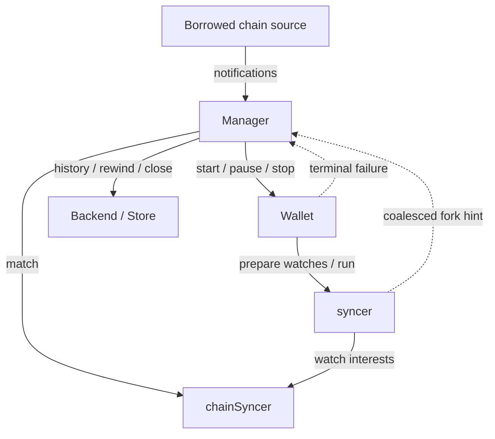

# ADR 0017: Manager Chain Routing

## Status

- **Status:** Proposed
- **Date:** 2026-11-17

## Relationships

- **Amends:** [ADR 0015](0015-sql-shared-chain-ownership.md).
- **Supersedes:** None.
- **Amended by:** None.
- **Superseded by:** None.

## 1. Problem

A Wallet can miss an unmined payment if publication precedes its live watches.
A catch-up worker also cannot rewind a database shared with other writers.
Readiness and recovery need clear owners without another dispatcher or frontier.

## 2. Context

The Manager foundation supplies one native reader, bounded ordered delivery,
typed Create admission and joined shutdown. Wallet workers persist their own
checkpoints and perform targeted rescans.

### Constraints

The caller starts and owns `ManagerConfig.ChainSource`. Manager borrows its
retained notification stream and does not stop the client or wait for channel
closure. SQL supports multiple Wallets; KVDB remains an isolated single Wallet.

## 3. Decision

Manager owns published membership, native input, shared recovery policy and
backend lifetime. chainSyncer owns watch registration, registry and matching.
Wallet owns setup, readiness and joined workers. syncer owns processing,
catch-up, scans and retry. The backend owns history queries, rewind and closure.

Start and Create call Wallet setup. SQL watch preparation finishes before
workers activate and membership is published; retained native input covers
this handoff. KVDB retains background initialization. Watch preparation never
waits for chain currency or historical catch-up. Retries rebuild watches after
committed work whose native registration failed.

A detecting syncer offers the first abandoned block through one bounded,
nonblocking hint slot, then yields. It must remain able to acknowledge its own
pause. Manager pauses Wallet writers, validates queued identity through its
backend, rewinds once and resumes. Native disconnects carry ordered authority;
queued evidence needs validation. Missing or obsolete evidence resumes without
rewind. A history-read failure warns and resumes for retry; a rewind failure
keeps writers paused until termination.

Indeterminate write effects escape syncer retry. Wallet reports the failure;
Manager wakes blocked delivery and applies aggregate shutdown policy on its
owner loop. Lifecycle admission chooses cleanup ownership. Accepted operations
settle and Wallet workers join before backend closure, including when Stop
races recovery or Create. No child disposes shared storage.

## 4. Rationale

Readiness before publication closes the mempool gap that block catch-up cannot
repair. Independent committed checkpoints let a current Wallet remain ready
while a sibling catches up. One recovery owner orders shared rewind against all
writers; scoped scans keep their existing Wallet-only persistence boundary.

Downward commands use child methods. Asynchronous reports are reserved for
worker facts that cannot wait on their own pause or join. No routing component
receives aggregate lifecycle authority.

## 5. Alternatives Considered

### Alternative: Readiness after worker activation

This allows processing to overlap setup and exposes a Wallet before its watches
exist. Preparing inside Wallet setup gives a single activation boundary.

### Alternative: Rewind from each worker

This permits one Wallet to invalidate history while a sibling is writing.
Manager reuses the existing pause/ready/resume barrier instead.

### Alternative: Another coordinator or durable frontier

Existing native retention, mailboxes and committed checkpoints provide the
required handoff and recovery. Additional delivery state has no current need.

## 6. Consequences

### Positive

Ownership follows component boundaries; startup and recovery have explicit
publication and writer barriers. Catch-up does not gate sibling readiness.

### Negative and Risks

Bounded delivery intentionally backpressures the reader. Stop must release
that wait and join owned work. Hints can coalesce; retry must reread committed
history. Broader caller-context migration remains separate in issue 1499.

## 7. Implementation Overview

The existing Manager loop receives native events, typed creation and recovery
hints. It calls Wallet startup/pause/stop methods and backend history/rewind
operations. Existing syncer workers process Wallet mailboxes and retry locally;
chainSyncer starts no reader worker. No schema or public API change is needed.

## 8. References

- [ADR 0015](0015-sql-shared-chain-ownership.md).
- [ADR 0004: Scoped rescans](0004-targeted-rescan-vs-rewind.md).
- [PR 1468: SQL notification cutover](https://github.com/btcsuite/btcwallet/pull/1468).
