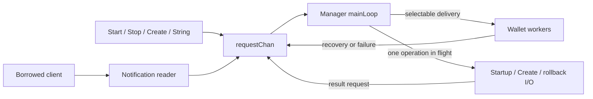

# ADR 0017: Manager Chain Routing

## Status

- **Status:** Accepted
- **Date:** 2026-11-03

## Relationships

- **Amends:** [ADR 0015](0015-sql-shared-chain-ownership.md), section 3.4's
  assignment of live transaction matching to Wallet processors.
- **Supersedes:** None.
- **Amended by:** None.
- **Superseded by:** None.

## 1. Problem

Several SQL Wallets share one backend notification stream. Independent readers
compete for events instead of each receiving its relevant transactions and
block progress. Forwarding every transaction to every Wallet repeats parsing
and relevance work. Manager needs enough information to select recipients
before their independently scheduled workers persist the transactions.

## 2. Context

Manager already owns aggregate lifecycle, the Wallet registry, shared SQL
storage, and the caller-provided chain source. Wallet owns its existing worker,
transaction persistence, synchronization status, catch-up, and explicit scans.

Wallets already declare address and outpoint interests during address delivery,
publication, synchronization initialization, and committed-scan refresh. Stored
addresses and ListOutputsToWatch reconstruct those interests, including outputs
spent by unmined transactions. These mechanisms can supply routing ownership
without live-event Store reads or another recovery cache.

### Constraints

- Preserve asynchronous historical catch-up, retry, and backend ordering.
- Install routing ownership before a successful native subscription can emit.
- A watched address or outpoint can belong to several Wallets.
- Preserve source order and bounded, lossless admission for each live target.
- Give every maintained Manager the same reader ownership; kvdb retains
  one Wallet per database and its existing address allocation behavior.
- Preserve native backend semantics rather than inventing uniform SPV mempool
  or subscription guarantees.

## 3. Decision

Manager owns a private chainSyncer through a private behavior interface: one
borrowed notification reader, an additive watch registry and live transaction
matching. One Manager runtime loop owns membership, publication, rollback
ordering and Store lifetime. Start, Stop, Create and String send typed requests
through one inbox; source events, recovery hints, failures and I/O results use
that same inbox. Wallets retain their existing processors and independent
lifetimes. Public method signatures do not change.

The loop selects mailbox delivery alongside incoming requests, so a full Wallet
mailbox cannot prevent shutdown or failure reporting. At most one temporary I/O
task performs startup, creation or rollback with fixed configuration, backend
and recipient inputs. It never changes Manager state. Its typed result returns
publication and cleanup decisions to the owner; the existing WaitGroup joins
it before Store closure. There is no standing I/O worker or generic job queue.

A Wallet registration identifies its Wallet ID and addresses or outpoints.
Manager records the association before calling the existing backend method,
without holding routing locks during I/O. Success means that native method
succeeded. Native helpers return classified errors to their callers. The
existing SQL backend selects synchronous preparation and terminal handling for
lost required watches; the KVDB backend keeps deferred preparation and local
retry. Workers and post-commit callers report through the owner inbox before
retrying or returning their native error. A fresh Manager reconstructs persisted obligations;
an already recorded association never suppresses native registration. The
registry indexes
each address or outpoint to its set of Wallet owners, allowing direct event
lookups and shared interests without scanning each Wallet. Its short mutex
protects the mutable sets; parsing, native I/O and delivery happen outside it.

Manager parses transaction output addresses once and unions recipients from
matching outputs and watched inputs. Input script addresses also match before
recovery learns their funding outpoints; they remain separate from output
credit metadata. A transaction reaches each interested Wallet once. Matching
outputs become watched outpoints before the next record or event is matched,
so a queued parent's spend remains routable before the
parent commits. Learned interests remain additive for replacement spends.
Store still determines account and credit ownership transactionally.

Events carry immutable prepared matches and original notification metadata.
Each Wallet has a capacity-one mailbox feeding its existing worker. An actual
filtered block reaches every current Wallet, including those with no matching
transactions. Header-only block notifications retain their wakeup meaning:
catch-up scans recovery-window addresses before advancing the checkpoint.
Control events other than disconnects use ordinary Wallet handlers.

Manager enrolls its reader before startup watches. Each event waits for an
owner receipt before intake continues, bounding native admission to one pending
event. Startup/Create I/O installs watches, then its result lets the owner
publish the complete recipient set before matching that event. Native queues
retain later events. Create waits for unfinished delivery before registration,
so it cannot wait on an intake reader still holding a preceding receipt.
Ordinary delivery remains asynchronous with respect to Wallet persistence.

For every backend, Manager owns live disconnects. It settles earlier Wallet
writes, rewinds the database once, and then releases processing. Wallet
creation and Store closure wait until the rewind settles. Historical batches
fetched before rollback are discarded and refetched; accepted targeted scans
continue their ranges. Successful rollback resumes dispatch directly.

Manager's reader lifetime is separate from each Wallet's synchronization and
recovery state. SQL Start and Create establish native watch readiness before
returning; each Wallet continues from its own committed checkpoint in the
background. No startup mempool backfill or aligned-tip guarantee is added.
Additional payload for a matching committed block uses Store idempotency
without advancing the checkpoint a second time.

Historical fork detection offers a hint through the same owner inbox and
returns to retry. The owner retains one coalesced hint while another operation
is active; workers recheck committed state on retry. The runtime rollback barrier checks that a hint still names
the stored abandoned block before mutating history. Manual and targeted scans
remain scoped to their Wallet; a current sibling need not wait for their
completion to become ready.

Lost SQL registrations, unexpected unmined failures and ambiguous processing
writes stop Manager. Definite input arbitration, mined/block errors and reads
retain catch-up/retry. Required source loss and rollback persistence failure
are terminal for every backend. The existing backend adapters select policy;
shared workers do not inspect backend kinds or legacy address-manager presence.

Stop is an ordinary inbox request. The owner rejects new mutations, settles
accepted startup/Create work and cancels its loop-local worker context to
release intake, delivery and rollback preparation when applicable. Accepted
durable rollback writes finish. Wallets, source intake and I/O join before
Store closes. Only then does lifetimeCtx signal aggregate completion. The
selected Stop caller receives cleanup errors; later callers join without
replaying them. A worker's failure report acknowledges policy without waiting
for cleanup that joins that same worker. Manager never starts/stops the borrowed
client or waits for its notification channel to close.

## 4. Rationale

Watch declarations already identify the Wallet that owns an interest. Recording
that identity before native activation avoids a registration gap without
querying an incompletely updated Store for every event. Learning outputs during
matching also handles parents that have only been admitted to a Wallet queue.

Existing Wallet workers preserve processing order and persistence boundaries.
A bounded mailbox keeps admission asynchronous without adding an unbounded
queue, dispatcher worker, or processing-completion coordinator.

## 5. Alternatives Considered

### Independent SQL backend readers

Competing receives cannot broadcast a single channel to multiple Wallets.

### Broadcast all transactions and match in each Wallet

This retains repeated parsing and per-Wallet relevance work on the live path.

### Caller-fed fanout with Wallet filtering (#1434)

[PR #1434](https://github.com/btcsuite/btcwallet/pull/1434) accepts ordered
events
from a caller and forwards them to Wallet workers, which select relevant
transactions. The caller must own source consumption and delivery, and each
Wallet repeats relevance/filtering work. Manager-owned consumption and recorded
watch declarations put those responsibilities together and let Manager prepare
transactions once before selecting recipients. Wallet workers retain their
persistence and recovery responsibilities.

### Query Store for recipients at delivery

A parent can still be queued when its child arrives. Durable ownership alone
cannot identify that child's recipient until the parent commits.

### Independent unbounded recipient queues

They hide a slow Wallet by growing memory and require additional lifecycle and
scheduling policy. Bounded backpressure is sufficient for the current contract.

## 6. Consequences

### Positive

- Manager consumes the shared stream once and owns live relevance decisions.
- Wallet synchronization and recovery remain independently scheduled.
- Existing native subscription, Store batch, and Wallet retry paths are reused.
- Pending-parent spends remain routable without persistence-completion waits.

### Negative and Risks

- A slow live Wallet can fill its mailbox and backpressure the shared reader,
  including while scanning or waiting for retry. Independent state does not
  imply unlimited independent throughput.
- Additive interests retain memory for the Manager lifetime. Deleting an
  outpoint on its first spend loses replacement and reorg-spend routing, and
  addresses can receive again. Any bounded retirement policy needs a separate
  decision; this design defines no GC threshold or background worker.
- A dead required source stops every Wallet served by that Manager.
- Live disconnects use the event height and terminal Manager error policy
  for every backend, including the single KVDB Wallet. Historical fork
  detection uses that same Manager barrier and each backend's actual Store
  rewind. KVDB block-identity reconciliation remains a storage concern.

## 7. Implementation Overview

Every Manager starts one runtime loop after construction and supplies one
private chainSyncer to its Wallets. The loop owns the Wallet map and backend
without Manager mutexes; only it writes the existing atomic Start guard and
enrolls/joins source intake and the single accepted I/O operation. Wallet watch producers delegate to
the chainSyncer; their existing processors consume
prepared events. Btcd and bitcoind keep their current address/outpoint/block
subscriptions. Neutrino keeps birthday initialization, historical address
registration, and no-op spent subscription. Kvdb delegates its native address
registration through the same owner and retains its one-Wallet storage limit.

Unit coverage checks registration order, shared recipients, unknown-prevout
input-address spends, queued-parent spends, progress, ordered delivery,
membership changes and joined shutdown.
Native integration coverage checks two-Wallet unmined delivery on full nodes
and confirmed ownership on full nodes and Neutrino. Reopen checks recover a
missed fork and restore watches before historical readiness on SQL and the
isolated single KVDB Wallet. Existing confirmed-watch replay covers persisted
SPV interests. The existing KVDB Store adapter normalizes missing block-hash
errors to the shared Store identity. SQL schema, queries and generated output
remain unchanged.

## 8. References

- [ADR 0015](0015-sql-shared-chain-ownership.md): aggregate lifecycle and the
  broader shared-chain coordination design.
- [ADR 0004](0004-targeted-rescan-vs-rewind.md): Wallet historical recovery.
- [ADR 0005](0005-no-auto-rescan-on-import.md): explicit recovery after import.
- [Scanning and synchronization](../scanning_sync_architecture.md): existing
  catch-up and recovery mechanisms.
