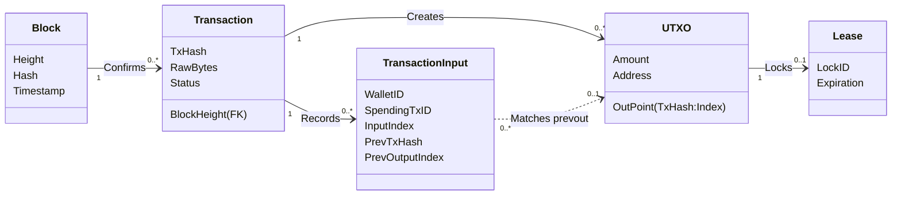
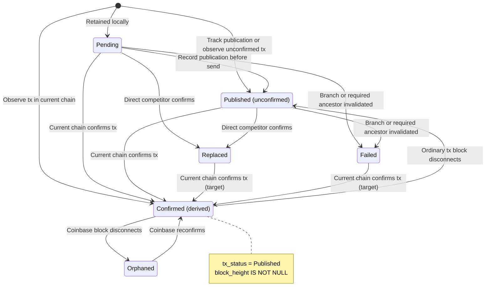
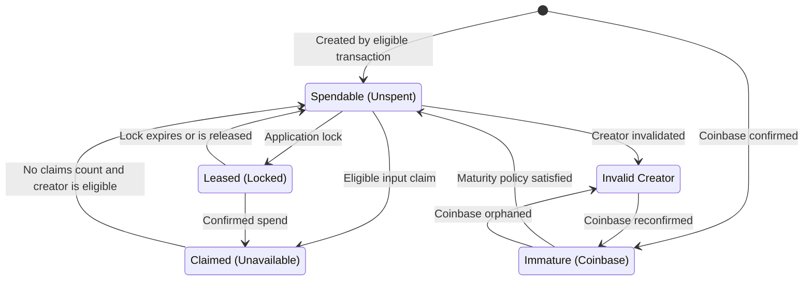
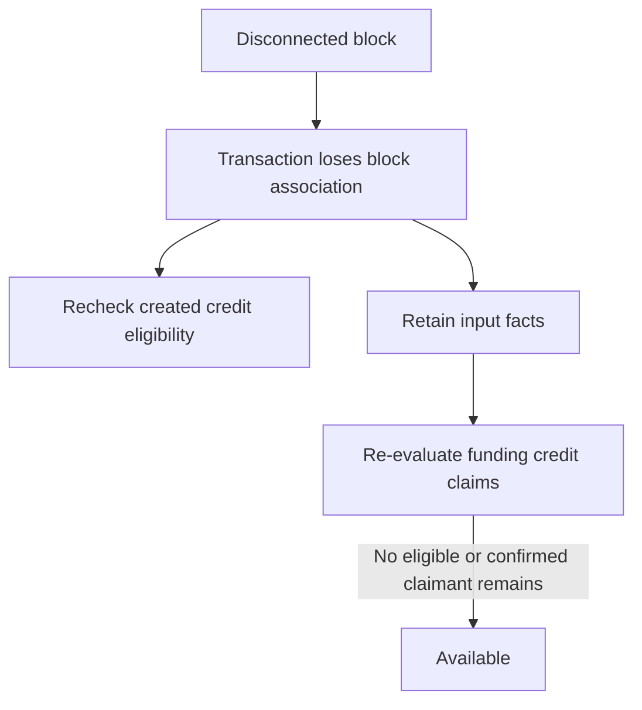
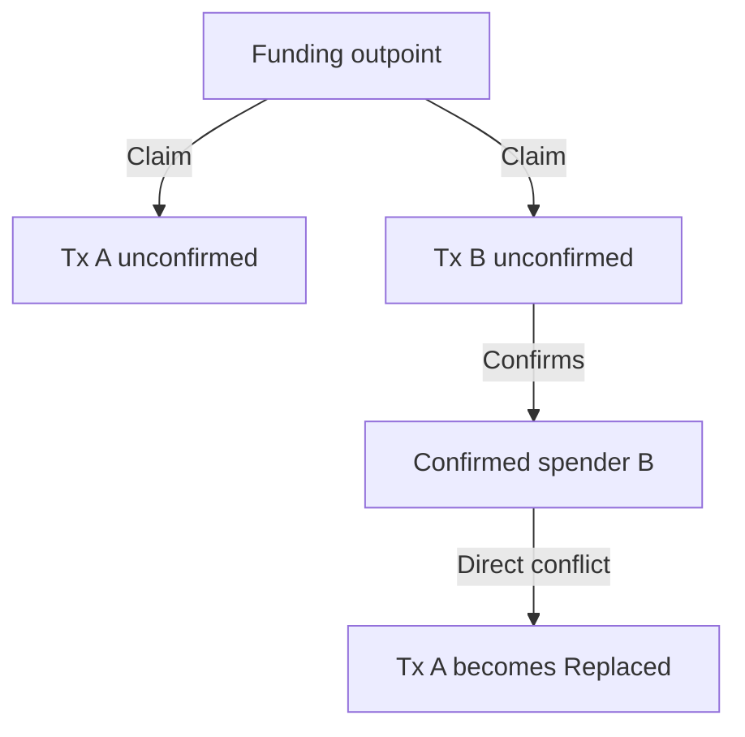
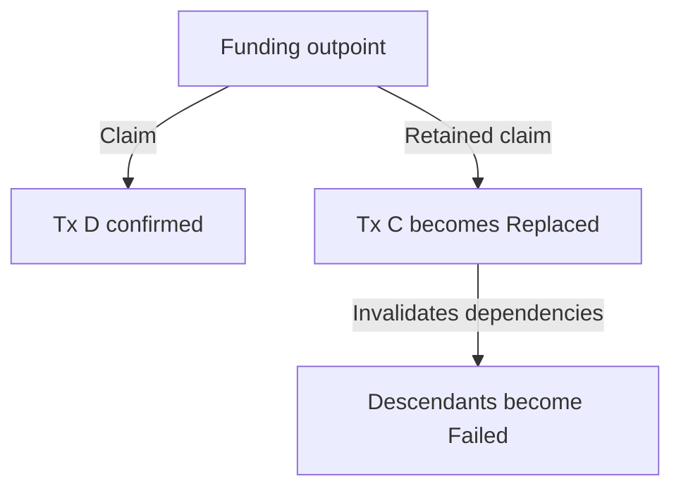

# Wallet Data Model and Lifecycle

This guide explains the target wallet model governed by
[ADR 0006](./adr/0006-wtxmgr-sql-schema.md), as amended by
[ADR 0018](./adr/0018-unconfirmed-transaction-candidates.md).
ADR0018 is authoritative for input relationships and spend lookup. Its target
is not yet fully implemented; precise rollback status restoration remains open.

[Transaction Invalidation Flows](./tx_invalidation_flows.md) describes the
current implementation's mutable credit-pointer cleanup. Those instructions
do not authorize clearing the target model's retained transaction inputs.

## 1. Design Philosophy

The `btcwallet` architecture is built upon a specific worldview: **The wallet is a UTXO Manager.**

While Bitcoin users often think in terms of "Balances" and "Transactions," the operational reality of the Bitcoin protocol is the **Unspent Transaction Output (UTXO)**. A wallet's primary responsibility is to discover, secure, and select these outputs for spending.

### 1.1 Structural vs. Operational Centrality

Our data model distinguishes between data integrity and operational efficiency:

*   **Structurally Transaction-Centered:** Data integrity flows from the parent Transaction to the child UTXO. A UTXO cannot exist without a creating transaction. If a transaction is invalid (double-spent), its outputs are invalid.
*   **Operationally UTXO-Centered:** The read path is optimized for UTXOs. 99% of wallet operations (calculating balance, selecting coins for a new payment) query the **UTXO set**, not the transaction history.

### 1.2 The "Immutable History" Policy

Ordinary confirmation, invalidation and rollback retain transaction history,
including the inputs of replaced or failed transactions. Status and current
block association determine eligibility without erasing those input facts.

Existing explicit branch deletion and recognized malformed/script-rejection
cleanup are exceptions. Deleting a transaction also deletes its input rows
through their cascading foreign key. Credit deletion follows the existing
[ADR 0011](./adr/0011-no-addresses-used-column.md) address-use rules. This model
introduces no separate input GC or history-pruning policy.

---

## 2. The Data Model

The wallet state is composed of five primary entities.

The diagram uses conceptual identifiers. SQL scopes records by wallet and uses
surrogate transaction IDs. An input can reference an external or undiscovered
parent with no owned credit row. Several inputs from competing transactions
can match one credit; there is no parent-UTXO foreign key.

Mapping (conceptual -> SQL):

| Concept | SQL (example) |
| --- | --- |
| `TxHash` | `transactions.tx_hash` (unique per `wallet_id`) |
| Transaction row ID | `(transactions.wallet_id, transactions.id)` |
| Owned outpoint | `(utxos.tx_id, utxos.output_index)`; wallet/hash from its creating transaction |
| Recorded input | `(tx_inputs.wallet_id, tx_inputs.tx_id, tx_inputs.input_index)` |
| Referenced outpoint | `(tx_inputs.wallet_id, tx_inputs.prev_tx_hash, tx_inputs.prev_output_index)` |
| Address (address book) | `addresses.id` (address-manager schema) |
| Confirmation | `transactions.block_height` (FK to `blocks(block_height)`) |
| Lease | `(utxo_leases.wallet_id, utxo_leases.utxo_id)` |

### 2.1 Entity Roles

*   **Block:** The anchor for time and confirmation. It handles reorgs. If a block is disconnected, linked transactions automatically lose their confirmation status.
*   **Transaction:** Retains raw bytes, wallet metadata, lifecycle status and
    current block association.
*   **TransactionInput:** Indexes an immutable input from those raw bytes.
    Confirmation and invalidation do not rewrite it; deleting its owning
    transaction removes it.
*   **UTXO:** The unit of value. This is the "Coin". It is the bridge between transactions.
*   **Lease:** A temporary, memory-like lock on a UTXO to prevent double-spending within the wallet application (e.g., reserving a coin for a Lightning channel open).

---

## 3. Transaction Lifecycle

A Transaction represents an event that *moves* value. Its lifecycle tracks the journey from user intent to blockchain finality.

### 3.1 State Machine

This graph describes the SQL target model using the five stored `tx_status`
values and derived confirmation. Its Published node has `block_height IS NULL`;
Confirmed means Published with a current block association. The initial marker
means no retained row; every retained row has a non-NULL status.

Chain confirmation takes precedence over retained Replaced/Failed labels.
Those two confirmation arrows are required target behavior. The current SQL
`CreateTx` confirmation path only reuses Pending/Published ordinary rows;
accepting retained Replaced/Failed rows remains an implementation gap.

After a competing block disconnects, recovery of a still-unconfirmed
Replaced/Failed transaction needs cause-aware reconciliation. Those statuses
alone do not preserve the earlier Pending/Published distinction. Restoring
that intent and Failed descendants according to their cause remains open in
ADR0018; the graph does not prescribe those unconfirmed recovery transitions.

### 3.2 Status vs. Confirmation

We distinguish between a transaction's **Validity** (Status) and its **Confirmation** (Block Height).

**1. Confirmation (Source of Truth: `BlockHeight`)**
*   **Unconfirmed:** `BlockHeight IS NULL`
*   **Confirmed:** `BlockHeight IS NOT NULL` (points to a valid block)

**2. Validity (Source of Truth: `Status`)**

| Status Code | Meaning | Affects Balance? |
| :--- | :--- | :--- |
| `0` (`pending`) | Created locally, before publication tracking. | **Yes** (Factual) |
| `1` (`published`) | Active wallet history recorded for publication or observed from the chain. | **Yes** (If valid) |
| `2` (`replaced`) | Direct conflict invalidated by a confirmed competitor. | **No** |
| `3` (`failed`) | Invalidated branch, including dependent descendants. | **No** |
| `4` (`orphaned`) | Coinbase tx that was reorged out (Invalid). | **No** |

Recording an unconfirmed competitor changes neither transaction's status.
When that competitor confirms, direct conflict roots become `replaced` and
invalidated descendants become `failed`. The graph distinguishes subsequent
canonical confirmation from unresolved recovery while still unconfirmed.

The wallet records `published` before notification registration or sending.
Retained unsuccessful attempts keep this status even if no send occurred; it
does not prove mempool acceptance. Preflight rejection records no new attempt.
After recording, transport errors, publication-policy failures and unknown
outcomes keep history and spend claims; recognized malformed or mandatory-script
rejections retain cleanup. `ErrTxRetained` also covers a failed readback after
recording. It identifies an attempt leaving active tracking in place, rather
than promising indefinite retention after a later validation rejection,
confirmed conflict or explicit deletion. General GC is deferred.

Current rebroadcast selects unconfirmed Published rows and sorts parents before
children. In the target input model, these must also have no confirmed
competitor or invalid required ancestor. Rebroadcast itself changes no status;
Pending, confirmed, Replaced, Failed and Orphaned rows are excluded.

*Additional invariant: Coinbase transactions cannot exist in the mempool. A coinbase transaction is either confirmed (`BlockHeight IS NOT NULL` and `Status = 1`, `published`) or orphaned (`Status = 4`, `orphaned`, and `BlockHeight IS NULL`).*

Factual-balance note: this model includes eligible `pending` and `published`
creators in the live credit set. More
conservative spendability policy (for example, excluding `pending` parents) is
applied by higher-level callers on top of that factual base.

There is no stored Abandoned status. Existing explicit branch deletion removes
records but cannot cancel a network broadcast attempt already in progress.

---

## 4. UTXO Lifecycle

A UTXO represents an owned credit. Derive its availability from the creating
transaction, matching input claims and their current transaction/block facts.
The target stores no spender pointer or separate UTXO status.

### 4.1 State Machine

### 4.2 Derivation Logic

These are derived query outcomes, not additional stored status values.
An unconfirmed Pending/Published claimant reserves its inputs while no
confirmed competitor or invalid required ancestor blocks it. A confirmed
claimant establishes a spend. Removing one does not release another's claim.

| Credit view | Creating transaction | Effective input claims | Meaning |
|---|---|---|---|
| Confirmed | Published with a current block | None | Subject to maturity, lease and caller policies. |
| Unconfirmed | Eligible Pending/Published without a block | None | Candidate credit; caller confirmation policy applies. |
| Immature | Confirmed coinbase | None | Excluded until maturity requirements are met. |
| Reserved | Eligible creator | At least one eligible unconfirmed claimant | Not available for ordinary selection. |
| Spent | Eligible creator | A current confirmed claimant | Retained spent-credit history. |
| Contingent change | Unconfirmed competing creator or its descendant | None | Discoverable with conflict metadata; excluded from safe sums and automatic selection. |
| Invalid creator | Failed, Replaced or Orphaned | Any | Excluded; legitimate recovery depends on cause and chain facts. |

Input rows remain even when their claimant stops reserving funds. Status and
chain facts determine whether the claim counts. Explicit coin control can
choose a compatible contingent branch after ancestry validation.

---

## 5. Operational Behaviors

### 5.1 Reorg Handling (Auto-Healing)

When the blockchain reorganizes (disconnects blocks):

1.  **Block** record is disconnected from the best chain (deleted/replaced).
2.  **Transactions** in that block have their `BlockHeight` set to `NULL`.
3.  **Effect (non-coinbase):** Regular transactions revert to `Unconfirmed` state (but remain `published`).
    *   **Coinbase special case:** Coinbase transactions from the disconnected block are marked `orphaned` (as per ADR 0006) instead of reverting to `Unconfirmed`, since they cannot exist outside of the block that created them.
4.  **Cascading Effect:**
    *   Outputs created by these txs become `Unconfirmed` (except for outputs of `orphaned` coinbase txs, which are no longer considered part of the spendable UTXO set).
    *   Input rows remain. A disconnected Published transaction can still
        reserve its funding outputs. A credit becomes unclaimed only if no
        eligible unconfirmed or confirmed transaction still claims it.

Implementation note: The SQL `blocks` table models the current best chain. During a disconnect, the best-chain association is removed (for example by deleting the `blocks` row at that height and inserting the new one). The coinbase status update MUST be atomic with clearing `BlockHeight` to avoid an invalid "unconfirmed coinbase" state.

Coinbase reconfirmation note: If an orphaned coinbase transaction re-enters the best chain, restoring it requires updating `BlockHeight` and `Status = 1` (`published`) atomically (one SQL statement within a transaction) to satisfy coinbase invariants.

Reconfirmation semantics:

*   The transaction keeps the same `tx_hash` and is associated with a new `block_height`.
*   Credits of the reconfirmed coinbase move from excluded to immature, and
    become eligible after maturity if no effective input claim blocks them.

Deep reorg note: A deep reorg disconnects a range of blocks. Keep status,
block and eligibility updates atomic under the existing backend boundaries.
Exact restoration of previously Replaced/Failed branches remains unresolved
in ADR0018; clearing a block association alone does not solve it.

### 5.2 RBF (Replace-By-Fee)

When the wallet records replacement candidate B spending A's input:

1. Retain both transactions and their input rows. Observing unconfirmed B
   changes neither status and does not choose a higher-fee winner.
2. Both eligible candidates reserve the funding output. Neither claim overwrites
   the other; their change remains contingent rather than independent safe
   funds.
3. If B confirms, its current block association establishes the spend. A becomes
   `replaced`, and A's invalidated descendants become `failed`.

### 5.3 Upstream Double-Spend (Invalidation)

Suppose unconfirmed C and competing D spend the same funding output:

1. Recording unconfirmed D changes neither transaction's status.
2. When D confirms, retain its block association and input facts. Indexed
   input lookup identifies C as a direct conflict, even for an external parent.
3. Mark C `replaced`, not `failed`. Its credits become unavailable, and its
   invalidated descendants become `failed`.
4. Keep the input rows of C and its descendants for history and later lookup.
   Their ineligibility releases only claims not held by another live candidate.

Architectural consequence: Recursive invalidation can require graph traversal across transaction chains. Typical wallet histories are shallow, but the design should acknowledge worst-case depth and define an execution strategy (batch processing, recursion limits, and/or iterative traversal) to avoid pathological performance.

Suggested implementation strategy:

1.  Start with a queue of newly-invalid transactions (double-spent, replaced, or orphaned).
2.  Apply the event-specific root status; confirmed-conflict roots become
    `replaced`, while their invalidated descendants become `failed`.
3.  Find recorded inputs referencing the affected transaction hashes.
4.  Follow those input relationships to discover dependent transactions.
5.  Repeat until the queue is empty.

This can be implemented with an application-side loop (portable across databases) or a database-side recursive CTE (PostgreSQL).

### 5.4 Coin Selection
Coin selection starts from owned credits and the input index:

1.  Exclude outputs with a confirmed spend or an eligible unconfirmed input
    claimant. Match wallet, creating transaction hash and output index; a
    missing credit pointer is not an availability test.
2.  Join the parent transaction and choose a caller-specific live-status
    filter.
    *   Conservative callers can require `Status = 1` (`published`).
    *   Zero-latency chaining can opt into `Status IN (0, 1)` (`pending`,
        `published`), but this creates a strict dependency: the parent must be
        broadcast before the child.
    *   If confirmation is required (e.g., for safety), add
        `AND BlockHeight IS NOT NULL`.
3.  Exclude contingent change from safe sums and automatic selection. Explicit
    coin control validates one compatible ancestry branch.
4.  Filter out active `Leases` and apply existing maturity requirements.

Important: There is no dedicated `spendable_utxos` view in the current branch.
Coin selection should build directly on factual UTXO queries and then apply its
own policy filters for pending parents, active leases, and immature coinbase
outputs. Active leases should be excluded using the caller's UTC `now` value,
not an implicit database-local timestamp.

Transaction reconstruction note: This model optimizes the high-frequency UTXO read path. Reconstructing a full transaction view (inputs/outputs for UI/history) is inherently more join-heavy and should be treated as a lower-frequency, separately optimized read path.

### 5.5 Multi-Wallet Concurrency & Consistency
When multiple wallets share a single database, the transaction graph remains
wallet-scoped through `transactions.wallet_id`, and other rows either carry
`wallet_id` directly or derive wallet ownership through that transaction graph.
This avoids conflicts and makes correctness properties explicit.

*   **Consistency model:** The system assumes ACID semantics from the database. Reorg handling, status transitions, and lease acquisition must be performed as explicit SQL transactions.
*   **Concurrency primitive:** UTXO leases are the wallet-level lock. Coin selection must exclude leased UTXOs, and lease acquisition should be treated as part of the same atomic unit as input selection.
*   **Coinbase maturity:** Coinbase UTXOs require 100 confirmations. This rule should be enforced in a single, well-defined caller-side policy path to avoid accidental selection of immature funds.

Suggested enforcement: a parameterized caller-side query helper or composition layer that takes `current_height` and filters out coinbase UTXOs where `current_height - block_height < 100`.
