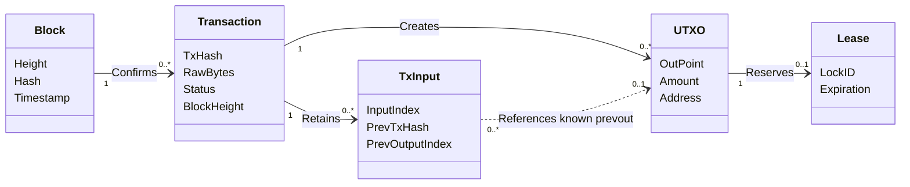
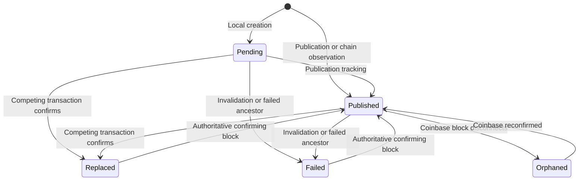
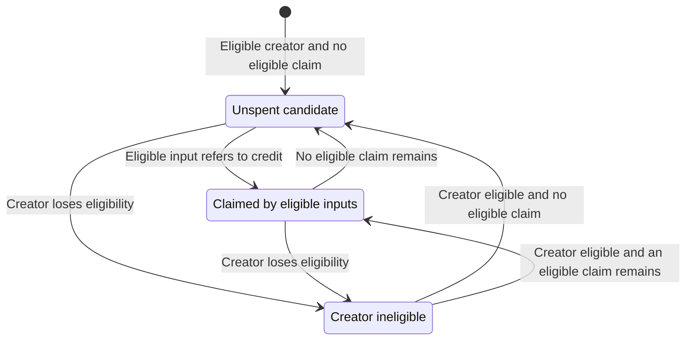
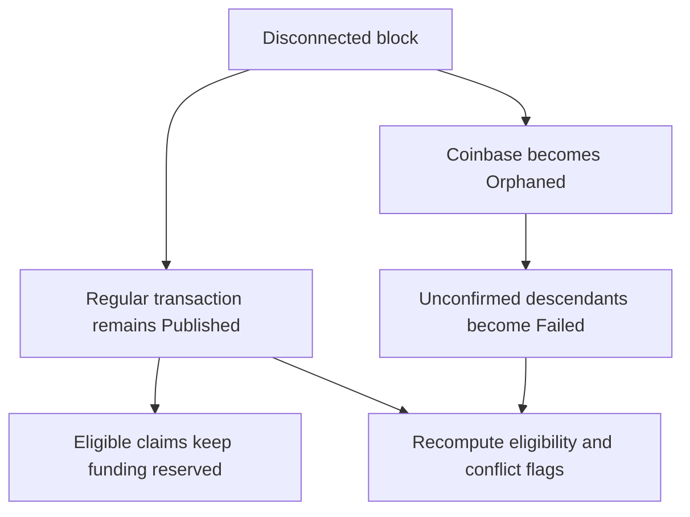
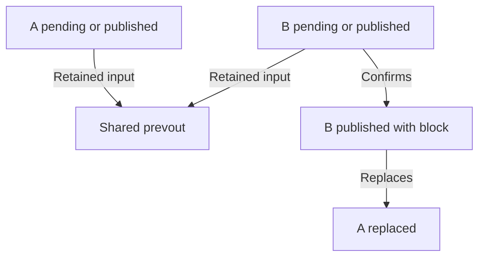
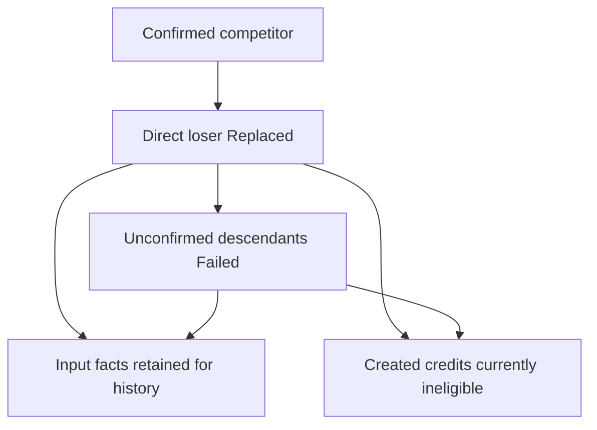

# Wallet Data Model and Lifecycle

This reference describes the SQL wallet's transaction and credit model.
Retained inputs record history; current transaction state determines which
claims affect credit availability. Native KVDB policy remains separate.

For the exact write-path rules that apply transaction ingress, invalidation, and rollback to the stored graph, see [Transaction Invalidation Flows](./tx_invalidation_flows.md).

## 1. Design Philosophy

The `btcwallet` architecture is built upon a specific worldview: **The wallet is a UTXO Manager.**

While Bitcoin users often think in terms of "Balances" and "Transactions," the operational reality of the Bitcoin protocol is the **Unspent Transaction Output (UTXO)**. A wallet's primary responsibility is to discover, secure, and select these outputs for spending.

### 1.1 Structural vs. Operational Centrality

Our data model distinguishes between data integrity and operational efficiency:

*   **Structurally Transaction-Centered:** Data integrity flows from the parent Transaction to the child UTXO. A UTXO cannot exist without a creating transaction. If a transaction is invalid (double-spent), its outputs are invalid.
*   **Operationally UTXO-Centered:** The read path is optimized for UTXOs. 99% of wallet operations (calculating balance, selecting coins for a new payment) query the **UTXO set**, not the transaction history.

### 1.2 The "Immutable History" Policy

Invalidation and replacement retain transaction rows and their input facts for
the wallet's audit trail. `failed`, `replaced` and `orphaned` history does not
contribute eligible claims or credits. This does not make history permanently
unrecoverable: an authoritative confirming block can restore retained history.
Explicit deletion of an allowed unmined leaf is a separate operation that
removes that transaction and its cascading input facts.

---

## 2. The Data Model

Transactions create credits and retain ordinary inputs independently of when
the wallet discovers a referenced credit.

All transaction facts are wallet-scoped. The dotted prevout relation is a
lookup, not a foreign key to a credit: an input can be recorded before its
parent transaction or wallet ownership is known. Multiple inputs can refer to
the same prevout without choosing one preferred spender.

| Concept | SQL identity |
| --- | --- |
| Transaction | `(transactions.wallet_id, transactions.id)`; hash unique per wallet |
| Retained input | `(tx_inputs.wallet_id, tx_inputs.tx_id, tx_inputs.input_index)` |
| Referenced prevout | `tx_inputs.prev_tx_hash`, `tx_inputs.prev_output_index` |
| Wallet credit | `(utxos.tx_id, utxos.output_index)` |
| Address | `addresses.id` |
| Confirmation | `transactions.block_height` references the best-chain block |
| Lease | `(utxo_leases.wallet_id, utxo_leases.utxo_id)` |

Credits derive wallet ownership by joining `utxos.tx_id` to
`transactions.id` and reading `transactions.wallet_id`.

### 2.1 Entity Roles

- **Block:** Anchors confirmation in the current best chain.
- **Transaction:** Records an attempt's hash, serialized bytes, status and block.
- **TxInput:** Retains an ordinary input's prevout, including unknown parents;
  its transaction's current eligibility determines whether it reserves funding.
- **UTXO:** Records a wallet credit independently of current spending claims.
- **Lease:** Reserves a credit for an application; it does not identify a spender
  or determine transaction eligibility.

---

## 3. Transaction Lifecycle

A Transaction represents an event that *moves* value. Its lifecycle tracks the journey from user intent to blockchain finality.

### 3.1 State Machine

Confirmation is orthogonal to status: confirmed rows are `published` with a
block. A real current-block observation can restore a retained `replaced` or
`failed` row, even if an ancestor remains terminal. Unmined observations do not
revive terminal history or undo existing confirmation. Disconnecting a former
winner does not itself restore its terminal competitors.

### 3.2 Status vs. Confirmation

We distinguish between a transaction's **Validity** (Status) and its **Confirmation** (Block Height).

**1. Confirmation (Source of Truth: `BlockHeight`)**
*   **Unconfirmed:** `BlockHeight IS NULL`
*   **Confirmed:** `BlockHeight IS NOT NULL` (points to a valid block)

**2. Validity (Source of Truth: `Status`)**

| Status Code | Meaning | Balance contribution |
| --- | --- | --- |
| `0` (`pending`) | Local attempt before publication tracking | Eligible unspent credits, excluding conflict-affected credits |
| `1` (`published`) | Tracked or observed attempt; not proof of mempool acceptance | Eligible unspent credits, excluding conflict-affected credits |
| `2` (`replaced`) | Direct loser of a confirmed competing spend | None until authoritative confirmation restores it |
| `3` (`failed`) | Invalidated attempt or unconfirmed descendant of an invalid branch | None until authoritative confirmation restores it |
| `4` (`orphaned`) | Coinbase disconnected from the best chain | None until reconfirmation, then maturity applies |

The wallet records `published` before notification registration or sending.
Retained failed attempts keep this status even if no network send occurred; it
does not prove mempool acceptance. Unconfirmed `published` rows participate in
automatic rebroadcast, while `pending` rows do not. Preflight rejection records
no new attempt. After recording, publication-policy failures and unknown
outcomes keep history and spend claims; recognized malformed or mandatory-script
rejections retain cleanup. `ErrTxRetained` also covers a failed readback after
recording. It identifies an attempt leaving active tracking in place, rather
than promising indefinite retention after a later validation rejection,
confirmed conflict or explicit deletion. General GC is deferred.

*Additional invariant: Coinbase transactions cannot exist in the mempool. A coinbase transaction is either confirmed (`BlockHeight IS NOT NULL` and `Status = 1`, `published`) or orphaned (`Status = 4`, `orphaned`, and `BlockHeight IS NULL`).*

SQL discovery lists credits created by `published` transactions. Local
`pending` credits remain stored and accessible through point lookup and
explicit transaction creation, while their inputs continue reserving funding.
Account/default automatic selection uses the published listing; explicit
outpoint selection can use pending credits for advanced chaining.

Account and `Balance` totals retain eligible pending credits but exclude
conflict-affected credits. `ListAddresses` balances aggregate listed, unflagged
credits, so
the two projections can differ before publication. Native KVDB keeps its own
listing policy. `published` remains tracking state, not mempool acceptance.

SQL `HasConflictingTx` means the credit's creator or an unconfirmed ancestor
shares an input with another eligible unconfirmed transaction known to the
wallet. It is computed from retained facts and current state, not stored or
checked against a mempool. Listed outputs can carry it, but safe totals and
automatic selection exclude them; explicit inputs can choose one compatible
branch. Confirmation or removal can clear it, while reorgs or new competing
observations can restore it. It provides no competing transaction ID. Safe totals
omit all known competing branches and can understate funds. Owning competing
alternatives does not guarantee that either one will confirm.

*Note: There is no "Abandoned" state. A broadcast transaction cannot be safely abandoned; it can only be invalidated by double-spending its inputs.*

---

## 4. UTXO Lifecycle

A credit's availability is derived from its creator's eligibility and retained
input claims. There is no stored spender pointer or independent UTXO status.

### 4.1 State Machine

Leases, coinbase maturity and conflict flags are separate properties of an
unspent candidate, not stored transitions in this diagram. An unspent credit
is not necessarily available to automatic selection.

### 4.2 Derivation Logic

`eligible_transactions` includes active `pending`/`published` transactions.
For unconfirmed rows, known ancestor invalidity or a confirmed competing spend
can make them ineligible. A transaction's own valid confirmation establishes
its eligibility without reviving terminal ancestors. Retained terminal input
facts remain available for history but do not reserve credits.

| Credit projection | Creator and claims | Reader/selection meaning |
| --- | --- | --- |
| Confirmed unspent | Confirmed eligible creator; no eligible claim | Available subject to maturity, leases and requested filters |
| Published unconfirmed | Eligible `published` creator; no eligible claim | Listed with any computed conflict flag |
| Local pending | Eligible `pending` creator; no eligible claim | Point lookup and compatible explicit chaining; omitted from discovery |
| Claimed | Any eligible input references the credit | Unavailable even if the claim predates credit discovery |
| Ineligible | Creator fails current eligibility | Excluded while ineligible; retained `replaced`/`failed` history can confirm |
| Orphaned coinbase | Creator is `orphaned` without a block | Excluded until reconfirmation; maturity then applies |

`HasConflictingTx` is computed from eligible unconfirmed competition in the
creator or its unconfirmed ancestry. Such outputs can be listed, but balances
and automatic selection omit them. Deleting or invalidating one claimant
releases funding only when no other eligible claim remains.

---

## 5. Operational Behaviors

### 5.1 Reorg Handling (Auto-Healing)

Disconnect removes the best-chain association and clears block heights. Regular
transactions remain `published` and unconfirmed; their retained inputs still
reserve funding while eligible. Coinbase status changes atomically with block
removal, and its unconfirmed descendants become `failed`. Losing confirmation
alone does not release an otherwise eligible regular spend or revive its
terminal competitors. Reads recompute eligibility and conflict flags from the
resulting state.

Reconfirmation associates the retained transaction hash with the current block.
Coinbase restoration atomically sets its block and `published` status, then
coinbase maturity applies again. A new authoritative block can also confirm
retained `replaced`/`failed` history; unconfirmed restoration policy is separate.

### 5.2 RBF (Replace-By-Fee)

Observing another unconfirmed spend of the same input retains both attempts;
no fee comparison assigns a preferred owner. Both eligible input claims reserve
the credit. Their unconfirmed change and affected descendants are flagged and
excluded from safe sums and automatic selection, while compatible explicit
selection remains possible.

When B confirms, direct competing attempts become `replaced` and their
unconfirmed descendants become `failed`. Input facts remain for history;
there is no mutable credit pointer to transfer from A to B.

### 5.3 Upstream Double-Spend (Invalidation)

Confirmed-input conflict discovery uses retained prevouts, including inputs
whose wallet credit was unknown when first recorded. The confirmed transaction
replaces direct losers and fails their unconfirmed descendants. Explicit branch
invalidation instead marks its root `failed` and also fails its descendants.
Historical detail reads extract input outpoints from stored serialized
transactions, independently of the claims used for current eligibility.

Credits from these rows are excluded while their creators are ineligible,
not permanently dead. A real confirming block can restore the specific
retained transaction it confirms; it does not implicitly revive its ancestors.
No unmined echo or competitor disconnect is treated as that authority.

### 5.4 Coin Selection

1. Start with credits whose creators are eligible and whose prevouts have no
   eligible retained input claim. Retaining several claims requires no single
   preferred-spender assignment.
2. Automatic account/default sources use Published discovery. Explicit point
   lookup can use Pending credits for chaining; explicit input sets must choose
   one compatible branch rather than combine incompatible alternatives.
3. Exclude `HasConflictingTx` outputs from balances and automatic selection.
   Discovery still exposes their flags. Account and `Balance` projections can
   include unflagged Pending credits omitted from discovery; address balances
   use the listed projection. Omitting all competing branches can understate
   funds and does not guarantee either alternative will confirm.
4. Apply requested confirmations, coinbase maturity and active lease policy.
   Lease expiry uses the caller's UTC time, not an implicit database timestamp.

There is no separate `spendable_utxos` view. Existing credit queries use the
retained-input eligibility rules; workflow policy remains with the caller.

### 5.5 Multi-Wallet Concurrency & Consistency
When multiple wallets share a single database, the transaction graph remains
wallet-scoped through `transactions.wallet_id`, and other rows either carry
`wallet_id` directly or derive wallet ownership through that transaction graph.
This avoids conflicts and makes correctness properties explicit.

*   **Consistency model:** The system assumes ACID semantics from the database. Reorg handling, status transitions, and lease acquisition must be performed as explicit SQL transactions.
*   **Concurrency primitive:** UTXO leases are the wallet-level lock. Coin selection must exclude leased UTXOs, and lease acquisition should be treated as part of the same atomic unit as input selection.
*   **Coinbase maturity:** Coinbase UTXOs require 100 confirmations. This rule should be enforced in a single, well-defined caller-side policy path to avoid accidental selection of immature funds.

Suggested enforcement: a parameterized caller-side query helper or composition layer that takes `current_height` and filters out coinbase UTXOs where `current_height - block_height < 100`.
